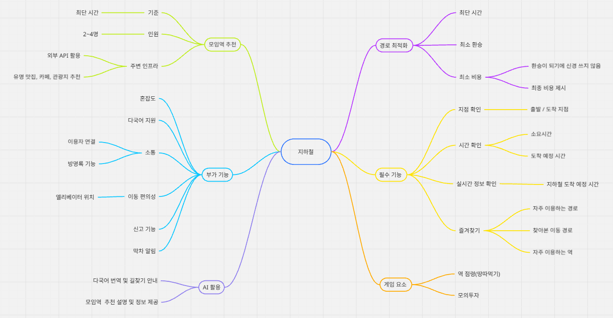

# SubFit 개념설계서 (2026.10.11 제출본)

> 이 파일은 제출한 Word 문서를 Markdown으로 변환한 **참고용 사본**입니다. 표지·서명·목차는 뺐습니다.
> **데이터 출처, 노선 범위, 부가 기능 범위는 이 문서가 아니라 `data/extra/ASSUMPTIONS.md`가 우선**입니다.
> (설계서 제출 이후 교수님 제공 가상 노선 데이터로 변경됨)

# 요약문

본 개념설계서는 AI 기반 다국어 지하철 길찾기 및 모임역 추천 애플리케이션 "SubFit"의 개념 설계 결과를 정리하였습니다. 한국을 방문하거나 체류하는 외국인은 복잡한 지하철 노선과 환승 체계 때문에 이동에 어려움을 겪지만, 기존 지하철 앱은 한국어 중심이거나 일부 언어만 지원하여 다양한 국적의 사용자를 포괄하지 못하고 있습니다. 본 프로젝트는 이러한 언어 장벽과 약속 장소 선정의 불편함을 함께 해결하는 것을 목표로 합니다.

SubFit의 AI 기능은 Google Gemini API를 활용합니다. 경로 계산과 모임역 후보 선정은 공공데이터로 구성한 지하철 노선 그래프에서 탐색 알고리즘으로 수행하고, AI는 그 계산 결과를 입력으로 받아 사용자가 선택한 언어로 환승 과정과 추천 이유를 설명하는 역할을 맡습니다. 계산과 설명을 분리함으로써 AI가 존재하지 않는 경로나 잘못된 환승 정보를 만들어 내는 위험을 줄이도록 설계하였습니다.

설계 과정은 브레인스토밍으로 아이디어를 창출한 뒤, 구현 가능성 0.3, 기능성 0.3, 시장성 0.2, 기여도 0.2를 판단 기준으로 설정하고 가중 순위 비교법을 적용하여 실시간 정보, 모임역 추천, 다국어 지원, 이동 편의성, 즐겨찾기를 상위 아이디어로 선정하는 순서로 진행하였습니다. 이어서 각 아이디어의 세부 기능을 퓨(Pugh) 방법으로 비교하여 우선 구현 대상을 결정하였고, 같은 방법으로 개발 환경을 비교하여 앱 배포 방식, Android 플랫폼, Flutter, FastAPI, PostgreSQL, Dijkstra를 최종 선정하였습니다.

그 결과 최단 시간 및 최소 환승 경로 안내, 사용자가 선택한 언어로의 결과 제공, 이동 시간과 환승 횟수를 고려한 모임역 추천을 핵심 기능으로 확정하였으며, 실시간 정보, 즐겨찾기, 이동 편의성 정보를 단계적으로 추가하는 구현 계획을 수립하였습니다. 이를 통해 다양한 국적의 사용자가 한국 지하철을 보다 쉽고 편리하게 이용할 수 있을 것으로 기대됩니다.

## Abstract

This conceptual design report presents the concept design of "SubFit," an AI-based multilingual subway navigation and meeting-station recommendation application. Foreign visitors and residents in Korea often struggle with the complex subway lines and transfer system, while existing subway apps are centered on Korean or support only a few languages. This project aims to address both the language barrier and the inconvenience of choosing a meeting place.

SubFit's AI functionality utilizes the Google Gemini API. Route calculation and meeting-station candidate selection are performed using search algorithms on a subway network graph constructed from public data. The AI then uses the calculated results as input to explain transfer routes and the reasons for recommendations in the language selected by the user. By separating calculation from explanation, the system is designed to reduce the risk of AI generating nonexistent routes or providing incorrect transfer information.

The design process began with brainstorming to generate ideas. Four evaluation criteria were established using the following weights: feasibility (0.3), functionality (0.3), marketability (0.2), and contribution (0.2). A weighted ranking method was then applied to identify real-time information, meeting-station recommendation, multilingual support, mobility convenience, and bookmarks as the leading ideas. Subsequently, the detailed functions of each idea were compared using the Pugh method to determine implementation priorities. The same method was used to evaluate development options, resulting in the selection of app-based deployment, the Android platform, Flutter, FastAPI, PostgreSQL and Dijkstra's algorithm.

As a result, the core functions were finalized as fastest and fewest-transfer route guidance, result delivery in the user's selected language, and meeting-station recommendation based on travel time and the number of transfers, with real-time arrival information, bookmarks, and mobility convenience information to be added in stages. Through this, users of various nationalities are expected to use the Korean subway more easily and conveniently.

# 1. 프로젝트 개요

## 1.1 프로젝트 배경

최근 한국을 방문하는 외국인 관광객, 유학생, 외국인 근로자의 수가 늘고 있습니다. 방한 외래관광객은 2,160만 5,499명으로 전년 동기 대비 19.5% 증가했으며(2025.09~2026.08) \[1\], 2025년 12월 말 기준 국내 체류외국인은 약 278만 명입니다\[2\]. 그러나 역 안 안내가 한국어 위주여서 외국인이 환승 방향을 찾지 못하는 사례가 보도되고 있으며\[6\], 1330 관광통역안내에서도 교통 관련 문의가 전년 대비 25% 증가하였습니다\[8\]. 외국인 이용 실태와 기존 서비스에 대한 상세 분석은 제안서 2장에 정리하였으며, 본 설계는 그 결과를 전제로 합니다\[7\].

기존 지하철·지도 앱은 길찾기 기능은 갖추고 있으나 다국어 지원이 일부 언어에 그치고, 환승 과정을 문장으로 풀어 설명하는 안내와 여러 명이 만날 역을 추천하는 기능은 제공하지 않습니다. 이에 대한 자세한 설명과 비교 분석 결과는 제안서에 정리되어 있습니다\[7\]. 본 프로젝트는 이 두 지점, 즉 다국어 경로 안내와 모임역 추천에 집중합니다.

## 1.2 프로젝트 목적

본 프로젝트의 목적은 AI 기반 다국어 지하철 길찾기 및 모임역 추천 애플리케이션을 개발하여, 한국 지하철 이용에 어려움을 겪는 외국인 사용자에게 다국어 경로 안내 서비스를 제공하는 것입니다. 설계 제품의 명칭은 "SubFit"으로 설정하였습니다.

본 프로젝트의 주안점은 언어 장벽을 줄이는 것과 약속 장소를 정하는 과정을 편리하게 만드는 것입니다. 이를 위해 AI를 활용하여 영어, 중국어, 일본어뿐 아니라 베트남어, 태국어, 인도네시아어 등 다양한 언어로 경로를 안내하고, 환승 정보를 일상적인 문장으로 풀어 설명하여 사용자가 쉽게 이해할 수 있도록 설계할 예정입니다. 또한 여러 사용자의 출발 위치를 기반으로 이동 시간과 환승 횟수를 고려한 모임역을 추천하여, 약속 장소 선정 과정에서 발생하는 불편함을 최소화하고자 합니다.

AI는 다음과 같은 구조로 활용합니다. 경로 계산과 모임역 후보 선정은 서울 열린데이터광장과 공공데이터포털의 공공데이터\[13\]\[14\]로 구성한 지하철 노선 그래프에서 탐색 알고리즘으로 수행하고, Google Gemini API\[9\]는 그 계산 결과만을 입력으로 받아 사용자가 선택한 언어로 환승 과정과 추천 이유를 설명합니다.

## 1.3 주요 사용자

주 사용 대상자는 한국 지하철 이용에 익숙하지 않은 외국인이며, 체류 성격에 따라 단기 방문 관광객, 외국인 유학생, 외국인 근로자로 구분합니다.

대표 사용 상황은 다음과 같습니다.

> 가) 캐리어를 든 일본인 관광객이 인천공항에서 명동 숙소로 이동하려 합니다. 노선도를 보아도 환승역과 이동 방향을 알기 어려워, 일본어로 환승 과정을 문장으로 안내받고자 합니다. → 길찾기 + 다국어 안내
>
> 나) 서로 다른 지역에 머무르는 유학생 3명이 저녁에 만나려 합니다. 각자 경로를 검색해 비교하기 어려워, 세 명의 이동 시간이 비슷하게 짧은 역을 추천받고 그 이유를 자신이 가장 편한 언어로 확인하고자 합니다. → 모임역 추천 + 추천 이유 설명

## 1.4 서비스 범위

본 프로젝트에서 다루는 서비스의 범위는 다음과 같습니다.

\[표 1\] 서비스 범위

| **항목**    | **내용**                                                                                                                                                   |
|-------------|------------------------------------------------------------------------------------------------------------------------------------------------------------|
| 플랫폼      | 안드로이드 (Android 11 이상). Flutter 기반으로 개발하여 향후 iOS로 확장할 수 있는 구조                                                                     |
| 서비스 지역 | 서울 권역 지하철. 서울교통공사 운영 노선(1~8호선) 중심                                                                                                     |
| 언어        | 영어, 중국어, 일본어뿐 아니라 베트남어, 태국어, 인도네시아어 등 약 20개 이상(70개 이상 확장)                                                               |
| 데이터      | 서울 열린데이터광장과 공공데이터포털의 지하철 노선·역 정보 및 실시간 열차 도착 정보 공공데이터\[13\]\[14\], 다국어 설명 생성을 위한 Google Gemini API\[9\] |
| 포함 기능   | 핵심: 길찾기(최단 시간·최소 환승), 다국어 안내, 모임역 추천 및 추천 이유 설명 (표 17 “설계” 항목 참조)                                                     |
| 향후        | 표 17 “향후” 항목 참조                                                                                                                                     |

## 1.5 주요 기능 및 서비스 개요

1)  길찾기: 출발역과 도착역을 입력하면 최단 시간 경로와 최소 환승 경로를 제공합니다.

2)  다국어 안내: 사용자가 선택한 언어로 결과를 제공하고, AI를 활용하여 환승 과정을 알기 쉬운 문장으로 설명합니다.

3)  모임역 추천: 여러 명의 출발역을 입력받아 이동 시간과 환승 횟수를 고려한 최적의 모임역을 추천하고, AI가 추천 이유를 설명합니다.

위 세 가지는 핵심 기능입니다. 이 외에 실시간 열차 도착 정보, 첫차·막차 정보, 역·경로·모임역 결과 즐겨찾기, 엘리베이터·에스컬레이터 위치와 출구 편의시설 정보를 부가 기능으로 포함하며, 실시간 열차 위치 등 7개 기능은 향후 확장 대상입니다. 전체 목록과 구분은 5장의 표 17에 정리하였습니다. 모임역 추천의 입력 인원은 2~4명이며, "최적의 모임역"은 참여자 전체의 이동 시간 합이 작으면서 참여자 간 이동 시간 편차가 작은 역으로 정의합니다.

## 1.6 기대효과

기대효과는 사용자, 사회의 두 측면으로 구분합니다. 사용자 측면에서는 자신이 잘 아는 언어로 경로와 환승 방법을 확인할 수 있어 역 안에서 길을 찾는 시간과 시행착오를 줄이고, 여러 명이 만날 역을 한 번의 검색으로 확인할 수 있습니다. 사회적 측면에서는 외국인의 대중교통 접근성을 높이고, 교통 관련 통역 문의가 늘고 있는 상황\[8\]에서 안내 인력의 부담을 더는 데 기여할 수 있습니다.

기대효과의 달성 여부는 다음 기준으로 확인합니다. 경로 탐색 성공률 95% 이상, 모임역 추천 성공률 90% 이상, 경로 탐색 응답 2초 이하, AI 설명 생성 응답 5초 이하, 그리고 1.3절의 두 사용 상황을 재현하는 시연 시나리오 2종의 정상 동작입니다.

# 2. 아이디어 창출

지하철 노선도 앱이 가질 수 있는 다양한 기능들에 중점을 두고 브레인스토밍 기법을 이용하여 아이디어를 창출하였습니다. 이를 통해 나온 아이디어들을 공통 분류로 묶고 마인드 맵 형식으로 나타내었습니다.

\[그림 1\] 아이디어 창출 마인드 맵

마인드 맵의 항목 가운데 일부는 3장의 평가 대상에서 제외하거나 다른 항목에 통합하였습니다. AI 활용(다국어 번역 및 길찾기 안내, 모임역 추천 설명)은 독립된 기능이 아니라 다국어 지원과 모임역 추천을 구현하는 수단이므로 별도 아이디어로 평가하지 않고 해당 아이디어에 포함하여 평가하였습니다.

# 3. 아이디어 다듬기

## 3.1 아이디어 판단 기준 결정

지금까지 나온 아이디어를 종합하고 구체화하기 위해 먼저 아이디어를 평가할 판단 기준을 정하였습니다. 여러 판단 기준에 대해 팀원들이 각각 10점 만점으로 평가한 뒤, 평균 점수를 계산하여 순위를 정하였습니다. 그 결과 평균 점수가 높은 항목을 중심으로 최종 판단 기준을 선정하였습니다.

\[표 2\] 아이디어 판단 기준 결정

| **판단 기준** | **얻은 점수** |            | **평균 점수** | **최종 순위** |
|---------------|---------------|------------|---------------|---------------|
|               | **이 진**     | **표혜정** |               |               |
| 구현 가능성   | 10            | 10         | 10            | 1             |
| 기능성        | 10            | 9          | 9.5           | 2             |
| 차별성        | 6             | 6          | 6             | 6             |
| 시장성        | 9             | 8          | 8.5           | 3             |
| 기여도        | 7             | 8          | 7.5           | 4 (공동)      |
| 목적부합성    | 7             | 8          | 7.5           | 4 (공동)      |
| 범용성        | 6             | 5          | 5.5           | 7             |

평가에 따라 구현 가능성 1위, 기능성 2위, 시장성 3위로 선정되었으며, 기여도와 목적부합성은 공동 4위로 평가되었습니다. 공동 4위 중 목적부합성은 아이디어가 프로젝트의 개발 목적과 얼마나 일치하는지를 평가하는 기준으로, 본 프로젝트에서 검토한 아이디어들이 주로 지하철 길찾기라는 전체 주제와 관련된 기능들로 구성되어 있어 아이디어 간 차이를 구분하기에는 변별력이 다소 낮다고 판단하였습니다. 반면 기여도는 각 아이디어가 사용자와 사회에 제공할 수 있는 가치뿐만 아니라 사회적·경제적으로 어느 정도 긍정적인 영향을 줄 수 있는지를 평가할 수 있어 아이디어를 비교하는 기준으로 더 적합하다고 판단하였습니다. 이에 따라 기여도를 최종 4위의 판단 기준으로 선정하였습니다.

## 3.2 아이디어 판단

마인드 맵으로 정리한 아이디어들을 다음 네 가지 판단 기준을 바탕으로 가중 순위 비교법을 사용해 선정하였습니다. 경로 최적화는 지하철 길찾기의 기본이 되는 필수 기능이므로 아이디어 평가 대상에서 제외하였으며, 구현 우선순위를 0순위로 선정하였습니다.

1)  구현 가능성: 개발 기간 내에 주어진 자원으로 구현 가능한가?

2)  기능성: 사용자에게 유용하고 만족스러운 경험을 제공할 수 있는가?

3)  시장성: 해당 기능이 시장에서 성공적으로 자리 잡을 가능성이 있는가?

4)  기여도: 사회적으로 혹은 경제적으로 얼마나 기여할 수 있는가?

각 평가 기준에 가중치를 차등 부여한 근거는 다음과 같습니다. 구현 가능성은 아이디어를 계획한 수준까지 완성할 수 있는지를 판단하는 가장 기본적인 기준이므로 높은 비중을 부여하였습니다. 또한 기능성은 프로젝트의 완성도와 사용자의 편의에 직접적으로 연결되어 있다고 판단하여 구현 가능성과 동일한 0.3의 가중치를 부여하였습니다. 시장성은 제안된 아이디어의 실제 활용 가능성과 잠재적 수요를 평가하는 중요한 기준입니다. 다만, 본 프로젝트는 상용화 자체보다 제안된 기능의 기술적 구현 가능성과 사용자 요구 충족에 중점을 두고 있으므로, 시장성의 가중치를 0.2로 설정하였습니다. 기여도 역시 사회적·경제적 가치를 평가하는 중요한 기준이지만, 실제 구현 가능성과 사용자에게 제공되는 기능적 가치에 비해서는 상대적으로 우선순위가 낮다고 판단하여 0.2의 가중치를 부여하였습니다. 따라서 구현 가능성 0.3, 기능성 0.3, 시장성 0.2, 기여도 0.2로 총합이 1이 되도록 가중치를 설정하였습니다. 가중치와 아래 표 3의 점수는 모두 팀원 2인이 각각 평가한 뒤 합의하여 확정한 값입니다.

\[표 3\] 아이디어 가중 순위 비교

<table>
<colgroup>
<col style="width: 22%" />
<col style="width: 12%" />
<col style="width: 12%" />
<col style="width: 12%" />
<col style="width: 12%" />
<col style="width: 12%" />
<col style="width: 12%" />
</colgroup>
<thead>
<tr class="header">
<th rowspan="2">
<strong>판단기준</strong>

<strong>아이디어</strong>
</th>
<th><strong>구현 가능성</strong></th>
<th><strong>기능성</strong></th>
<th><strong>시장성</strong></th>
<th><strong>기여도</strong></th>
<th rowspan="2"><strong>총점 
(10)</strong></th>
<th rowspan="2"><strong>최종 
순위</strong></th>
</tr>
<tr class="odd">
<th><strong>0.3</strong></th>
<th><strong>0.3</strong></th>
<th><strong>0.2</strong></th>
<th><strong>0.2</strong></th>
</tr>
</thead>
<tbody>
<tr class="odd">
<td>모임역 추천</td>
<td>8</td>
<td>9</td>
<td>7</td>
<td>8</td>
<td>8.1</td>
<td><strong>2</strong></td>
</tr>
<tr class="even">
<td>역 점령 (땅따먹기)</td>
<td>8</td>
<td>3</td>
<td>2</td>
<td>2</td>
<td>4.1</td>
<td>10</td>
</tr>
<tr class="odd">
<td>모의투자</td>
<td>7</td>
<td>2</td>
<td>3</td>
<td>2</td>
<td>3.7</td>
<td>11</td>
</tr>
<tr class="even">
<td>실시간 정보</td>
<td>9</td>
<td>9</td>
<td>9</td>
<td>8</td>
<td>8.8</td>
<td><strong>1</strong></td>
</tr>
<tr class="odd">
<td>즐겨찾기</td>
<td>9</td>
<td>7</td>
<td>7</td>
<td>7</td>
<td>7.6</td>
<td><strong>4</strong></td>
</tr>
<tr class="even">
<td>혼잡도</td>
<td>4</td>
<td>7</td>
<td>8</td>
<td>7</td>
<td>6.3</td>
<td>9</td>
</tr>
<tr class="odd">
<td>다국어 지원</td>
<td>8</td>
<td>8</td>
<td>7</td>
<td>9</td>
<td>8</td>
<td><strong>3</strong></td>
</tr>
<tr class="even">
<td>소통 기능</td>
<td>7</td>
<td>6</td>
<td>7</td>
<td>6</td>
<td>6.5</td>
<td>8</td>
</tr>
<tr class="odd">
<td>이동 편의성</td>
<td>7</td>
<td>8</td>
<td>7</td>
<td>8</td>
<td>7.5</td>
<td><strong>5</strong></td>
</tr>
<tr class="even">
<td>신고 기능</td>
<td>7</td>
<td>8</td>
<td>6</td>
<td>5</td>
<td>6.7</td>
<td>7</td>
</tr>
<tr class="odd">
<td>막차 알림</td>
<td>9</td>
<td>6</td>
<td>5</td>
<td>7</td>
<td>6.9</td>
<td>6</td>
</tr>
</tbody>
</table>

위와 같이 가중 순위 비교법을 활용하여 아이디어를 비교한 결과, 실시간 정보, 모임역 추천, 다국어 지원, 즐겨찾기, 이동 편의성이 각각 1~5위를 차지했습니다. 나머지 아이디어 역시 평가 결과에 따라 순위를 정하였으며, 이를 바탕으로 프로젝트에 우선적으로 반영할 주요 아이디어를 선정하였습니다.

이후 선정된 아이디어를 실제 기능으로 구체화하는 과정에서, 세부 기능들의 중요도와 구현 우선순위를 판단하기 위해 퓨(Pugh) 방법을 활용하여 한 차례 더 비교 및 평가하였습니다.

# 4. 아이디어 최종 선정

## 4.1 퓨(Pugh) 방법을 이용한 아이디어 선정

앞서 3.2 아이디어 판단 단계에서 각 아이디어를 평가하여 우선순위를 정하였으며, 그중 상위 5개의 아이디어를 우선적으로 구현할 주요 기능으로 선정하였습니다. 이후 각 아이디어를 보다 구체화하기 위해 세부 기능을 도출하고, 퓨(Pugh) 방법\[3\]을 상대적 우선순위를 판단하기 위한 도구로 변형해 적용함으로써 세부 기능 간 구현 우선순위를 비교하였습니다. 각 아이디어별로 기준이 되는 세부 기능을 선정한 후, 기준 기능보다 우수한 경우 ‘+’, 유사한 경우 ‘S’, 상대적으로 부족한 경우 ‘-’로 평가하였습니다. 이를 통해 각 아이디어에서 우선적으로 구현할 세부 기능을 선정하였습니다. 추가적으로 구현 가능성이 "-"인 기능은 종합 점수와 관계없이 향후 기능으로 분류하였습니다. 다만 본 프로젝트의 차별성에 직접 연결되는 기능 한 가지는 예외적으로 구현 대상에 포함하기로 하였으며, 이에 해당하는 기능은 모임역 추천 기능의 ‘이동시간 공평성 기준 추천’입니다. 최종 구현 순서는 평가 결과와 함께 기능 간의 의존 관계 및 선후 관계를 고려하여 결정하였습니다.

평가에 사용한 네 가지 기준은 다음과 같습니다.

1)  구현 가능성: 현재 팀의 기술 수준과 기간 안에 구현 가능한가?

2)  사용자 편의성: 사용자의 앱 이용을 더 편리하게 만들어주는가?

3)  핵심 기능 연관성: 지하철 길찾기 앱의 핵심 목적과 밀접한가?

4)  차별성: 기존 지하철 앱과 비교했을 때 특징이 될 수 있는가?

한 아이디어 안의 세부 기능을 비교할 때 각각의 특성이 더 잘 드러나게 하기 위해 3.2와 다른 기준을 적용하였습니다.

각 표의 "선정" 열에 사용한 분류의 정의는 다음과 같습니다. "우선 구현"은 핵심 기능으로서 가장 먼저 구현하는 기능, "부가 구현"은 핵심 기능(길찾기·다국어 안내·모임역 추천)의 구현이 끝난 뒤 이번 학기 안에 구현하는 기능, "향후"는 이번 학기 범위 밖의 확장 기능입니다. 5장의 표 17에서는 우선 구현과 부가 구현을 묶어 "설계"로, 향후를 "향후"로 표기하였습니다.

### 4.1.1 실시간 정보

\[표 4\] 실시간 정보 세부기능 선정

<table>
<colgroup>
<col style="width: 22%" />
<col style="width: 12%" />
<col style="width: 12%" />
<col style="width: 12%" />
<col style="width: 12%" />
<col style="width: 12%" />
<col style="width: 12%" />
</colgroup>
<thead>
<tr class="header">
<th><strong>세부기능</strong></th>
<th><strong>구현 가능성</strong></th>
<th><strong>사용자 
편의성</strong></th>
<th><strong>핵심 기능 연관성</strong></th>
<th><strong>차별성</strong></th>
<th><strong>종합 점수</strong></th>
<th><strong>선정</strong></th>
</tr>
</thead>
<tbody>
<tr class="odd">
<td>실시간 열차 도착정보 
(기준)</td>
<td>S</td>
<td>S</td>
<td>S</td>
<td>S</td>
<td>0</td>
<td>부가 구현</td>
</tr>
<tr class="even">
<td>첫차, 막차 정보</td>
<td>+</td>
<td>S</td>
<td>S</td>
<td>-</td>
<td>0</td>
<td>부가 구현</td>
</tr>
<tr class="odd">
<td>열차 지연정보</td>
<td>-</td>
<td>+</td>
<td>+</td>
<td>+</td>
<td>+2</td>
<td>향후</td>
</tr>
<tr class="even">
<td>실시간 열차 위치</td>
<td>-</td>
<td>+</td>
<td>+</td>
<td>+</td>
<td>+2</td>
<td>향후</td>
</tr>
</tbody>
</table>

### 4.1.2 모임역 추천

\[표 5\] 모임역 추천 세부기능 선정

<table style="width:100%;">
<colgroup>
<col style="width: 28%" />
<col style="width: 11%" />
<col style="width: 11%" />
<col style="width: 11%" />
<col style="width: 11%" />
<col style="width: 11%" />
<col style="width: 11%" />
</colgroup>
<thead>
<tr class="header">
<th><strong>세부기능</strong></th>
<th><strong>구현 
가능성</strong></th>
<th><strong>사용자 
편의성</strong></th>
<th><strong>핵심 기능 연관성</strong></th>
<th><strong>차별성</strong></th>
<th><strong>종합 점수</strong></th>
<th><strong>선정</strong></th>
</tr>
</thead>
<tbody>
<tr class="odd">
<td>최단시간 기준 추천 
(기준)</td>
<td>S</td>
<td>S</td>
<td>S</td>
<td>S</td>
<td>0</td>
<td>우선 구현</td>
</tr>
<tr class="even">
<td>최소환승 기준 추천</td>
<td>S</td>
<td>+</td>
<td>+</td>
<td>+</td>
<td>+3</td>
<td>우선 구현</td>
</tr>
<tr class="odd">
<td>이동시간 공평성 기준 추천</td>
<td>-</td>
<td>+</td>
<td>+</td>
<td>+</td>
<td>+2</td>
<td>우선 구현</td>
</tr>
<tr class="even">
<td>추천역 TOP3 및 비교 정보</td>
<td>+</td>
<td>+</td>
<td>S</td>
<td>+</td>
<td>+3</td>
<td>향후</td>
</tr>
<tr class="odd">
<td>추천 이유 및 주변 인프라</td>
<td>+</td>
<td>+</td>
<td>+</td>
<td>+</td>
<td>+4</td>
<td>우선 구현</td>
</tr>
</tbody>
</table>

### 4.1.3 다국어 지원

\[표 6\] 다국어 지원 세부기능 선정

<table>
<colgroup>
<col style="width: 25%" />
<col style="width: 12%" />
<col style="width: 12%" />
<col style="width: 12%" />
<col style="width: 12%" />
<col style="width: 12%" />
<col style="width: 12%" />
</colgroup>
<thead>
<tr class="header">
<th><strong>세부기능</strong></th>
<th><strong>구현 가능성</strong></th>
<th><strong>사용자 
편의성</strong></th>
<th><strong>핵심 기능 연관성</strong></th>
<th><strong>차별성</strong></th>
<th><strong>종합 점수</strong></th>
<th><strong>선정</strong></th>
</tr>
</thead>
<tbody>
<tr class="odd">
<td>앱 UI 다국어 지원 
(기준)</td>
<td>S</td>
<td>S</td>
<td>S</td>
<td>S</td>
<td>0</td>
<td>우선 구현</td>
</tr>
<tr class="even">
<td>역명 다국어 표기</td>
<td>+</td>
<td>+</td>
<td>+</td>
<td>S</td>
<td>+3</td>
<td>우선 구현</td>
</tr>
<tr class="odd">
<td>길찾기 결과 다국어 제공</td>
<td>S</td>
<td>+</td>
<td>+</td>
<td>+</td>
<td>+3</td>
<td>우선 구현</td>
</tr>
<tr class="even">
<td>실시간 정보 다국어 제공</td>
<td>-</td>
<td>+</td>
<td>S</td>
<td>+</td>
<td>+1</td>
<td>향후</td>
</tr>
<tr class="odd">
<td>안내 및 오류 메시지 다국어</td>
<td>+</td>
<td>+</td>
<td>S</td>
<td>S</td>
<td>+2</td>
<td>우선 구현</td>
</tr>
</tbody>
</table>

### 4.1.4 이동 편의성

\[표 7\] 이동 편의성 세부기능 선정

<table>
<colgroup>
<col style="width: 25%" />
<col style="width: 12%" />
<col style="width: 12%" />
<col style="width: 12%" />
<col style="width: 12%" />
<col style="width: 12%" />
<col style="width: 12%" />
</colgroup>
<thead>
<tr class="header">
<th><strong>세부기능</strong></th>
<th><strong>구현 가능성</strong></th>
<th><strong>사용자 
편의성</strong></th>
<th><strong>핵심 기능 연관성</strong></th>
<th><strong>차별성</strong></th>
<th><strong>종합 점수</strong></th>
<th><strong>선정</strong></th>
</tr>
</thead>
<tbody>
<tr class="odd">
<td>엘리베이터 위치 제공 
(기준)</td>
<td>S</td>
<td>S</td>
<td>S</td>
<td>S</td>
<td>0</td>
<td>부가 구현</td>
</tr>
<tr class="even">
<td>에스컬레이터 위치 제공</td>
<td>+</td>
<td>S</td>
<td>S</td>
<td>S</td>
<td>+1</td>
<td>부가 구현</td>
</tr>
<tr class="odd">
<td>장애인 화장실 위치</td>
<td>+</td>
<td>S</td>
<td>-</td>
<td>S</td>
<td>0</td>
<td>향후</td>
</tr>
<tr class="even">
<td>교통약자 이동경로 제공</td>
<td>-</td>
<td>+</td>
<td>+</td>
<td>+</td>
<td>+2</td>
<td>향후</td>
</tr>
<tr class="odd">
<td>출구별 편의시설 정보</td>
<td>+</td>
<td>+</td>
<td>S</td>
<td>+</td>
<td>+3</td>
<td>부가 구현</td>
</tr>
</tbody>
</table>

### 4.1.5 즐겨찾기

\[표 8\] 즐겨찾기 세부기능 선정

<table>
<colgroup>
<col style="width: 22%" />
<col style="width: 12%" />
<col style="width: 12%" />
<col style="width: 12%" />
<col style="width: 12%" />
<col style="width: 12%" />
<col style="width: 12%" />
</colgroup>
<thead>
<tr class="header">
<th><strong>세부기능</strong></th>
<th><strong>구현 가능성</strong></th>
<th><strong>사용자 
편의성</strong></th>
<th><strong>핵심 기능 연관성</strong></th>
<th><strong>차별성</strong></th>
<th><strong>종합 점수</strong></th>
<th><strong>선정</strong></th>
</tr>
</thead>
<tbody>
<tr class="odd">
<td>역 즐겨찾기 
(기준)</td>
<td>S</td>
<td>S</td>
<td>S</td>
<td>S</td>
<td>0</td>
<td>부가 구현</td>
</tr>
<tr class="even">
<td>경로 즐겨찾기</td>
<td>S</td>
<td>+</td>
<td>+</td>
<td>S</td>
<td>+2</td>
<td>부가 구현</td>
</tr>
<tr class="odd">
<td>모임역 추천 결과 저장</td>
<td>+</td>
<td>S</td>
<td>+</td>
<td>+</td>
<td>+3</td>
<td>부가 구현</td>
</tr>
<tr class="even">
<td>최근 검색 기록</td>
<td>+</td>
<td>+</td>
<td>S</td>
<td>-</td>
<td>+1</td>
<td>향후</td>
</tr>
</tbody>
</table>

퓨(Pugh) 방법을 활용하여 각 아이디어의 세부 기능을 비교한 결과, 우선적으로 구현할 기능을 다음과 같이 선정하였습니다.

첫째, 실시간 정보에서는 열차 지연정보와 실시간 열차 위치가 가장 높은 평가를 받았습니다. 두 기능은 사용자 편의성과 핵심 기능 연관성, 차별성 측면에서 높은 평가를 받았으나 실시간 데이터를 안정적으로 확보하고 연동해야 한다는 점에서 구현 난이도가 높다고 판단하였습니다. 따라서 실시간 열차 도착정보를 기본 기능으로 부가 구현하고, 비교적 구현이 용이한 첫차·막차 정보를 함께 제공하기로 하였습니다. 열차 지연정보와 실시간 열차 위치는 구현 가능성이 "-"로 평가되었으므로, 앞서 정한 규칙에 따라 향후 기능으로 분류하였습니다.

둘째, 모임역 추천에서는 추천 이유 및 주변 인프라 제공 기능이 가장 높은 평가를 받았으며, 이동시간 공평성 기준 추천과 추천역 TOP3 및 비교 정보 제공 또한 사용자 편의성과 차별성 측면에서 높은 평가를 받았습니다. 다만 실제 구현 순서는 퓨(Pugh) 평가 결과뿐만 아니라 각 기능 간의 선후 관계와 의존성을 함께 고려하여 결정하였습니다. 먼저 최단 시간 기준 추천은 모임역을 선정하기 위한 가장 기본적인 기능으로, 이후의 추천 기능을 구현하기 위한 기반이 되므로 최우선으로 구현하기로 하였습니다. 다음으로 단순히 이동시간이 짧은 역을 추천하는 것에서 나아가 사용자 간 이동시간의 차이를 고려할 수 있도록 이동시간 공평성 기준 추천 기능을 구현하기로 하였습니다. 이후 계산된 추천 결과를 사용자가 이해할 수 있도록 각 사용자의 이동시간과 추천 기준 등을 제시하는 추천 이유 및 주변 인프라 제공 기능을 구현하고, 마지막으로 시간이 충분하다면 후보역을 비교하여 선택할 수 있도록 추천역 TOP3 및 비교 정보 제공 기능으로 확장하기로 하였습니다.

셋째, 다국어 지원에서는 역명 다국어 표기와 길찾기 결과 다국어 제공이 공동으로 가장 높은 평가를 받았으며, 안내 및 오류 메시지 다국어 지원이 그 뒤를 이었습니다. 앱 UI 다국어 지원은 전체 다국어 기능의 기반이 되는 기능이므로 기본적으로 구현하기로 하였습니다. 이에 따라 앱 UI와 역명, 길찾기 결과 및 주요 안내 메시지를 사용자가 선택한 언어로 제공하도록 구성하였습니다. 반면 실시간 정보의 전체 내용을 다국어로 제공하는 기능은 실시간 데이터 처리와 번역 과정이 추가로 필요하므로 구현 난이도를 고려하여 향후 추가 기능으로 선정하였습니다.

넷째, 이동 편의성에서는 출구별 편의시설 정보가 가장 높은 평가를 받았으며, 교통약자 이동경로, 에스컬레이터 위치 정보 순으로 평가되었습니다. 교통약자 이동경로는 사용자 편의성과 차별성 측면에서 높은 평가를 받았으나, 역 내부의 이동경로와 편의시설 간 연결정보를 활용해야 하므로 구현 난이도가 높다고 판단하여 향후 확장 기능으로 선정하였습니다. 장애인 화장실 위치 정보는 이동 편의에는 도움이 되지만 본 프로젝트의 핵심인 지하철 경로 탐색과의 직접적인 연관성이 상대적으로 낮아 우선 구현 대상에서는 제외하였습니다.

마지막으로 즐겨찾기에서는 모임역 추천 결과 저장이 종합 점수 3점으로 가장 높은 평가를 받았으며, 경로 즐겨찾기가 그 뒤를 이었습니다. 즐겨찾기 기능군 역시 부가 구현 단계에 해당하며, 그 안에서는 기능군의 기반이 되는 역 즐겨찾기를 먼저 구현하고, 경로 즐겨찾기와 본 프로젝트의 특징인 모임역 추천 결과 저장을 함께 제공하기로 하였습니다. 최근 검색 기록은 구현 가능성은 높지만 기존 지하철 앱이 일반적으로 제공하는 기능이어서 차별성이 "-"로 평가되었으므로, 향후 기능으로 분류하였습니다.

이를 바탕으로 핵심 길찾기 및 모임역 추천 기능, 다국어 지원 기능을 우선 구현한 뒤, 실시간 정보, 즐겨찾기, 이동 편의성을 단계적으로 추가하는 방향으로 개발 계획을 수립하였습니다. 다국어 지원의 경우 외국인 사용자를 대상으로 하는 본 프로젝트의 출발점이므로 후순위로 미루지 않고 길찾기 결과 화면과 함께 처음부터 적용합니다.

## 4.2 퓨(Pugh) 방법을 이용한 개발환경 및 플랫폼 선정

선정된 기능들을 보다 효율적으로 설계하기 위해 퓨(Pugh) 방법을 통해 개발환경 및 플랫폼을 분석하였습니다.

비교 대상은 배포 형태, 플랫폼, 프론트엔드 프레임워크, 백엔드 프레임워크, 데이터베이스, AI 모델, 경로 탐색 알고리즘의 일곱 가지입니다. 각 항목에서 일반적인 대안을 기준안으로 두고 ‘+’, ‘S’, ‘-’로 평가하였으며, 기준안 자체가 선정될 수도 있습니다.

### 4.2.1 배포 형태 및 플랫폼 선정

\[표 9\] 배포 형태 선정

| **판단 기준**            | **웹(PWA) (기준)** | **모바일 앱** |
|--------------------------|--------------------|---------------|
| 설치 없는 접근성         | S                  | \-            |
| 오프라인·백그라운드 동작 | S                  | \+            |
| 기기 기능(알림 등) 활용  | S                  | \+            |
| 모바일 사용 흐름 적합성  | S                  | \+            |
| 종합 점수                | 0                  | +2            |

본 서비스는 지하철 이동 중에 한 손으로 사용하는 상황이 대부분이므로, 설치형 모바일 앱이 웹보다 적합하다고 판단하였습니다.

\[표 10\] 플랫폼 선정

| **판단 기준**                       | **iOS (기준)** | **Android** |
|-------------------------------------|----------------|-------------|
| 팀 보유 테스트 기기                 | S              | \+          |
| 개발 중 기기 설치·배포 절차         | S              | \+          |
| 개발 장비 제약(별도 장비 필요 여부) | S              | \+          |
| 국내 사용자 점유율                  | S              | \+          |
| 종합 점수                           | 0              | +4          |

구현 및 시연 플랫폼은 Android(Android 11 이상)로 선정하였습니다. 개발 중 앱을 기기에 설치하는 절차가 단순하며, iOS 빌드에 필요한 별도 장비 제약이 없기 때문입니다. 다만 외국인 관광객 중에는 iPhone 사용자가 많으므로, 하나의 코드로 iOS까지 확장할 수 있는 크로스플랫폼 프레임워크를 사용하여 향후 확장 가능성을 유지합니다.

### 4.2.2 프론트엔드 프레임워크 선정

\[표 11\] 프론트엔드 프레임워크 선정

| **판단 기준**       | **React Native (기준)** | **Flutter** |
|---------------------|-------------------------|-------------|
| 구현 용이성         | S                       | S           |
| 학습 난이도         | S                       | \-          |
| UI 구현 및 일관성   | S                       | \+          |
| 앱 성능             | S                       | \+          |
| 라이브러리/API 활용 | S                       | S           |
| 유지보수 및 확장성  | S                       | \+          |
| 종합 점수           | 0                       | +2          |

모바일 애플리케이션 개발 환경을 선정하기 위해 Flutter\[4\]와 React Native\[5\]를 퓨(Pugh) 방법으로 비교하였습니다. React Native를 기준안으로 설정하고 구현 용이성, 학습 난이도, UI 구현 및 일관성, 앱 성능, 라이브러리/API 활용, 유지보수 및 확장성을 기준으로 평가하였습니다. 비교 결과 Flutter는 Dart 언어를 새롭게 학습해야 한다는 점에서 초기 학습 부담이 존재하지만, UI 구현의 일관성, 성능 및 유지보수 측면에서 상대적인 장점이 있다고 판단하였습니다. 또한 본 프로젝트는 지하철 경로, 실시간 정보, 모임역 추천 등 다양한 정보를 여러 화면에서 시각적으로 제공해야 하므로 UI 구성과 관리가 용이한 Flutter가 프로젝트에 보다 적합하다고 판단하여 최종 개발 환경으로 선정하였습니다.

### 4.2.3 백엔드 프레임워크 및 데이터베이스 선정

\[표 12\] 백엔드 프레임워크 선정

| **판단 기준**                            | **Django (기준)** | **FastAPI** |
|------------------------------------------|-------------------|-------------|
| REST API 중심 구조 적합성                | S                 | \+          |
| 학습 및 초기 구성 부담                   | S                 | \+          |
| API 문서 자동 생성                       | S                 | \+          |
| 관리자 화면 등 기본 제공 기능            | S                 | \-          |
| Python 생태계(AI·데이터 라이브러리) 연동 | S                 | S           |
| 종합 점수                                | 0                 | +2          |

본 프로젝트의 서버는 화면을 직접 만들지 않고 앱에 데이터를 전달하는 REST API 중심 구조입니다. 따라서 Django가 강점을 갖는 관리자 화면 같은 기본 제공 기능보다 API 작성과 문서화의 편의가 더 중요하다고 판단하여 FastAPI를 선정하였습니다. 두 프레임워크 모두 Python 기반이므로 Gemini API와 데이터 처리 라이브러리 연동에는 차이가 없다고 보았습니다.

\[표 13\] 데이터베이스 선정

| **판단 기준**                    | **SQLite (기준)** | **PostgreSQL** |
|----------------------------------|-------------------|----------------|
| 관계형 데이터(역·노선·환승) 표현 | S                 | S              |
| 서버 환경에서의 동시 접속 처리   | S                 | \+             |
| 운영·백업 등 서버 운용 기능      | S                 | \+             |
| 초기 설정 부담                   | S                 | \-             |
| 종합 점수                        | 0                 | +1             |

지하철 노선·역·환승 정보는 역과 역의 연결 관계로 표현되는 관계형 데이터이므로 관계형 데이터베이스를 사용합니다. 초기 설정은 SQLite가 간단하지만, 서버에서 여러 사용자의 요청을 동시에 처리해야 하므로 동시 접속 처리와 운영 측면에서 유리한 PostgreSQL을 선정하였습니다.

서버는 개발과 시연 단계에서 팀의 로컬 환경에서 실행하며, 앱은 동일 네트워크에서 서버에 접속합니다.

### 4.2.4 AI 모델 선정

다국어 안내에는 두 가지 접근이 있습니다. 하나는 Papago\[10\]나 Google 번역 같은 번역 API로 미리 만든 한국어 문장을 번역하는 방식이고, 다른 하나는 생성형 AI(LLM)로 경로 데이터로부터 설명 문장을 직접 생성하는 방식입니다. 번역 API는 비용이 낮고 동작이 예측 가능하지만, 환승 횟수·대기 상황 등 조건에 따라 달라지는 설명을 모두 한국어 템플릿으로 먼저 만들어야 하고, 모임역 추천 이유처럼 상황을 요약해 설명하는 문장은 생성할 수 없습니다. 본 프로젝트는 "환승 과정을 일상적인 문장으로 풀어 설명"하는 것이 목적이므로 생성형 AI를 사용하고, 번역 API는 역명 등 고정 문구의 보조 수단으로만 검토합니다.

\[표 14\] AI 모델 선정

<table>
<colgroup>
<col style="width: 33%" />
<col style="width: 22%" />
<col style="width: 22%" />
<col style="width: 22%" />
</colgroup>
<thead>
<tr class="header">
<th><strong>판단 기준</strong></th>
<th><strong>OpenAI API (기준)</strong></th>
<th><strong>Google Gemini API</strong></th>
<th><strong>Anthropic Claude API</strong></th>
</tr>
</thead>
<tbody>
<tr class="odd">
<td>예산(총 5만 원) 내 
사용 가능성(무료 제한, 단가)</td>
<td>S</td>
<td>+</td>
<td>S</td>
</tr>
<tr class="even">
<td>다국어 문장 생성 품질</td>
<td>S</td>
<td>S</td>
<td>S</td>
</tr>
<tr class="odd">
<td>문서·예제 확보</td>
<td>S</td>
<td>S</td>
<td>S</td>
</tr>
<tr class="even">
<td>Python 연동 용이성</td>
<td>S</td>
<td>S</td>
<td>S</td>
</tr>
<tr class="odd">
<td>종합 점수</td>
<td>0</td>
<td>+1</td>
<td>0</td>
</tr>
</tbody>
</table>

생성형 AI 간 비교에서는 예산 제약이 가장 큰 판단 기준입니다. 무료 사용량과 호출 단가를 고려할 때 학생 프로젝트 예산 범위 안에서 활용 가능하다고 판단한 Google Gemini API\[9\]를 선정하였습니다. 예산 제약에 대한 자세한 내용은 제안서\[7\] 3.4절을 참고하시기 바랍니다.

### 4.2.5 경로 탐색 알고리즘 선정

\[표 15\] 경로 탐색 알고리즘 선정

| **판단 기준**          | **BFS (기준)** | **Dijkstra** |
|------------------------|----------------|--------------|
| 이동 시간(가중치) 반영 | S              | \+           |
| 환승 횟수 기준 탐색    | S              | \+           |
| 구현 난이도            | S              | \-           |
| 종합 점수              | 0              | +1           |

BFS는 역의 개수만을 기준으로 하므로 역 간 이동 시간과 환승 소요 시간을 반영할 수 없습니다. 본 프로젝트는 최단 시간과 최소 환승을 모두 제공해야 하므로 간선 가중치를 반영하는 Dijkstra 알고리즘\[12\]을 선정하였습니다. 최소 환승 경로는 같은 그래프에서 환승 발생 시 큰 가중치를 주는 방식으로 함께 계산합니다.

### 4.2.6 개발 환경 요약

\[표 16\] 선정된 개발 환경

| **구분**         | **선정 결과**                      | **비고**                                   |
|------------------|------------------------------------|--------------------------------------------|
| 배포 형태·플랫폼 | 모바일 앱 / Android 11 이상        | Flutter 기반으로 iOS 확장 가능             |
| 프론트엔드       | Flutter                            | UI 일관성·유지보수\[4\]                    |
| 백엔드           | FastAPI                            | REST API 중심, 문서 자동화                 |
| 데이터베이스     | PostgreSQL                         | 동시 접속·운영                             |
| AI               | Google Gemini API                  | 예산 제약 고려\[9\]                        |
| 경로 탐색        | Dijkstra 알고리즘                  | 이동 시간·환승 가중치 반영\[12\]           |
| 데이터           | 서울 열린데이터광장·공공데이터포털 | 노선·역 정보, 실시간 도착 정보\[13\]\[14\] |

# 5. 기능의 설계 및 구현 계획

위의 과정들을 거쳐 구체적인 기능의 설계와 구현 계획을 세웠습니다.

\[표 17\] 기능 설계 및 구현 계획

<table>
<colgroup>
<col style="width: 10%" />
<col style="width: 41%" />
<col style="width: 18%" />
<col style="width: 14%" />
<col style="width: 14%" />
</colgroup>
<thead>
<tr class="header">
<th><strong>번호</strong></th>
<th><strong>기능/부품</strong></th>
<th><strong>계획 사항 
(설계/향후)</strong></th>
<th><strong>설계 난이도 (상/중/하)</strong></th>
<th><strong>구현 난이도 (상/중/하)</strong></th>
</tr>
</thead>
<tbody>
<tr class="odd">
<td>1</td>
<td>최단 시간 (경로 추천)</td>
<td>설계</td>
<td>중</td>
<td>중</td>
</tr>
<tr class="even">
<td>2</td>
<td>최소 환승 (경로 추천)</td>
<td>설계</td>
<td>중</td>
<td>중</td>
</tr>
<tr class="odd">
<td>3</td>
<td>출발/도착 지점 확인</td>
<td>설계</td>
<td>하</td>
<td>하</td>
</tr>
<tr class="even">
<td>4</td>
<td>소요 시간 및 도착 예정 시간 제공</td>
<td>설계</td>
<td>중</td>
<td>중</td>
</tr>
<tr class="odd">
<td>5</td>
<td>첫차, 막차 정보</td>
<td>설계</td>
<td>하</td>
<td>하</td>
</tr>
<tr class="even">
<td>6</td>
<td>실시간 열차 도착 정보</td>
<td>설계</td>
<td>하</td>
<td>중</td>
</tr>
<tr class="odd">
<td>7</td>
<td>실시간 열차 위치</td>
<td>향후</td>
<td>상</td>
<td>상</td>
</tr>
<tr class="even">
<td>8</td>
<td>열차 지연 정보</td>
<td>향후</td>
<td>상</td>
<td>중</td>
</tr>
<tr class="odd">
<td>9</td>
<td>모임역 추천(최단시간 기준)</td>
<td>설계</td>
<td>중</td>
<td>중</td>
</tr>
<tr class="even">
<td>10</td>
<td>모임역 추천(최소환승 기준)</td>
<td>설계</td>
<td>중</td>
<td>중</td>
</tr>
<tr class="odd">
<td>11</td>
<td>모임역 추천(이동시간 공평성)</td>
<td>설계</td>
<td>중</td>
<td>중</td>
</tr>
<tr class="even">
<td>12</td>
<td>추천 이유 및 주변 인프라 정보 제공</td>
<td>설계</td>
<td>상</td>
<td>중</td>
</tr>
<tr class="odd">
<td>13</td>
<td>추천역 TOP3 및 비교 정보 제공</td>
<td>향후</td>
<td>상</td>
<td>중</td>
</tr>
<tr class="even">
<td>14</td>
<td>앱 UI 다국어 지원</td>
<td>설계</td>
<td>하</td>
<td>하</td>
</tr>
<tr class="odd">
<td>15</td>
<td>역명 다국어 표기</td>
<td>설계</td>
<td>하</td>
<td>하</td>
</tr>
<tr class="even">
<td>16</td>
<td>길찾기 결과 다국어 제공</td>
<td>설계</td>
<td>중</td>
<td>하</td>
</tr>
<tr class="odd">
<td>17</td>
<td>안내 및 오류 메시지 다국어 제공</td>
<td>설계</td>
<td>중</td>
<td>중</td>
</tr>
<tr class="even">
<td>18</td>
<td>실시간 정보 다국어 제공</td>
<td>향후</td>
<td>중</td>
<td>상</td>
</tr>
<tr class="odd">
<td>19</td>
<td>역 즐겨찾기</td>
<td>설계</td>
<td>하</td>
<td>중</td>
</tr>
<tr class="even">
<td>20</td>
<td>경로 즐겨찾기</td>
<td>설계</td>
<td>하</td>
<td>중</td>
</tr>
<tr class="odd">
<td>21</td>
<td>모임역 추천 결과 저장</td>
<td>설계</td>
<td>중</td>
<td>중</td>
</tr>
<tr class="even">
<td>22</td>
<td>최근 검색 기록</td>
<td>향후</td>
<td>하</td>
<td>중</td>
</tr>
<tr class="odd">
<td>23</td>
<td>엘리베이터 위치 제공</td>
<td>설계</td>
<td>중</td>
<td>중</td>
</tr>
<tr class="even">
<td>24</td>
<td>에스컬레이터 위치 제공</td>
<td>설계</td>
<td>중</td>
<td>중</td>
</tr>
<tr class="odd">
<td>25</td>
<td>출구별 편의시설 정보 제공</td>
<td>설계</td>
<td>중</td>
<td>중</td>
</tr>
<tr class="even">
<td>26</td>
<td>교통약자 이동경로 제공</td>
<td>향후</td>
<td>상</td>
<td>상</td>
</tr>
<tr class="odd">
<td>27</td>
<td>장애인 화장실 위치 제공</td>
<td>향후</td>
<td>상</td>
<td>중</td>
</tr>
</tbody>
</table>

# 참고 문헌

\[1\] 한국관광공사, 한국관광 데이터랩, 「글로벌 방한 관광객」 국적별 방한 외래관광객 통계(글로벌 방한 관광객_한국관광데이터랩_202509-202608), 2025.09~2026.08 기준 - <https://datalab.visitkorea.or.kr/> (조회일: 2026.10.07)

\[2\] 관계부처 합동, 「2026년 외국인정책 시행계획(중앙행정기관)」, 2026.4. - <https://www.immigration.go.kr/bbs/immigration/226/493596/download.do>

\[3\] What is Pugh Matrix and How to use it? - <https://www.managementstudyguide.com/pugh-matrix.htm>

\[4\] Flutter - <https://flutter.dev/>

\[5\] React Native - <https://reactnative.dev/>

\[6\] 한국경제, 서울 주요 지하철역의 한국어 위주 안내로 인한 외국인 이용객 혼란 관련 보도, 2026.02.13. - <https://www.hankyung.com/article/202602135768i>

\[7\] 제안서 – SubFit 제안서, 2026.10.11

\[8\] 문화체육관광부·한국관광공사, 「1330 서비스 이용 트렌드 분석서」, 2024.08. - <https://knto.or.kr/pressRelease/548690>

\[9\] Google, Gemini API Documentation - <https://ai.google.dev/gemini-api/docs>

\[10\] 네이버, Papago - <https://papago.naver.com/>

\[11\] Google, Cloud Translation - <https://cloud.google.com/translate>

\[12\] E. W. Dijkstra, "A Note on Two Problems in Connexion with Graphs", Numerische Mathematik 1, pp. 269-271, 1959.

\[13\] 서울특별시, 서울 열린데이터광장(지하철역 정보 및 실시간 도착 정보 Open API) - <https://data.seoul.go.kr/>

\[14\] 행정안전부, 공공데이터포털 - <https://www.data.go.kr/>
