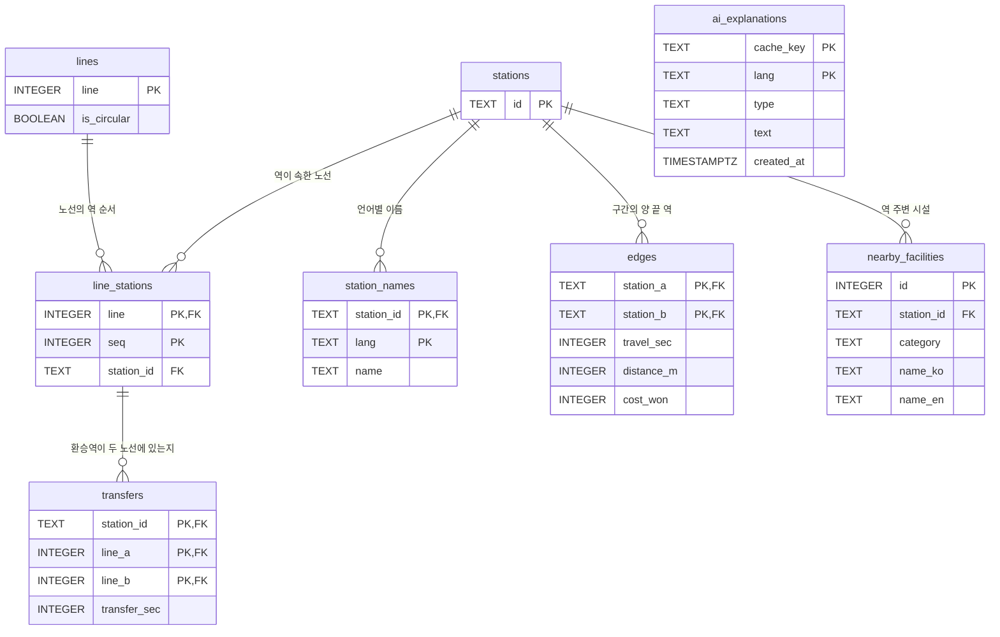

# SubFit DB 구조 (PostgreSQL)

> 작성 2026-11-06. 테이블 정의는 `backend/app/db/schema.sql`, 데이터 넣기는 `scripts/load_db.py`.
> 데이터 규칙은 `data/extra/ASSUMPTIONS.md`가 우선이다.

## 한눈에 보기

- 표는 8개다. 6개는 `load_db.py`가 원본 xlsx와 `data/extra` CSV로 채우고, 2개(주변 인프라, AI 설명 캐시)는 나중에 서버가 채운다.
- **즐겨찾기 표는 없다.** 즐겨찾기는 휴대폰(앱)에만 저장한다 (ASSUMPTIONS.md, 팀 결정 2026-11-06).
- 경로 계산(`backend/app/routing`)은 지금 DB가 아니라 파일을 직접 읽는다 (`load_network`). DB의 역·구간 표도 같은 파일에서 채우므로 내용은 같다. **CSV를 고치면 `load_db.py`를 다시 실행**해서 DB도 맞춘다.

## 실행 방법

PostgreSQL이 켜져 있어야 한다. 명령은 모두 저장소 최상위에서 실행한다.

```bash
# 처음 한 번
createdb subfit                              # DB가 아직 없을 때만
source .venv/bin/activate
pip install -r scripts/requirements.txt -r backend/requirements.txt
# .env의 DATABASE_URL 확인 (예: postgresql://localhost:5432/subfit)

# 표 만들기 + 데이터 넣기 (데이터가 바뀔 때마다, 몇 번을 실행해도 됨)
python scripts/load_db.py
```

성공하면 표별 행 수와 `✅ 적재 완료, 검증 통과`가 나온다. 실패하면 이유를 보여 주고 DB는 실행 전 그대로 둔다.

## DB가 처음이라면: 용어

| 용어 | 뜻 | 이 프로젝트의 예 |
|---|---|---|
| 테이블(표) | 엑셀 시트와 비슷하다. 행 하나 = 한 건, 컬럼 = 항목 | `stations` 표의 한 행 = 역 하나 |
| 기본 키 (PK) | 행 하나를 콕 집어 주는 값. 같은 값은 두 번 들어갈 수 없다 | `stations.id`. 역 `"101"`은 한 번만 있다 |
| 외래 키 (FK, `REFERENCES`) | "이 값은 저 표에 실제로 있어야 한다"는 약속. DB가 직접 막아 준다 | `station_names.station_id` → `stations.id`. 없는 역의 이름은 넣을 수 없다 |
| `UNIQUE` | 기본 키는 아니지만 겹치면 안 되는 값 | 같은 언어 안에서 역 이름 중복 금지 |
| `CHECK` | 값이 지켜야 하는 조건 | `travel_sec > 0`, 주변 인프라 종류는 4개만 |
| 트랜잭션 | 여러 작업을 "전부 성공 아니면 전부 취소"로 묶는 것. 확정 = commit, 취소 = rollback | `load_db.py` 전체가 트랜잭션 하나 |
| upsert | 있으면 고치고, 없으면 넣기 (`INSERT … ON CONFLICT`) | `lines`, `stations` 표 |

## 라이브러리를 고른 이유

| 쓰는 것 | 이유 |
|---|---|
| **psycopg 3** (`psycopg[binary]`) | Python에서 PostgreSQL에 접속하는 가장 표준적인 도구다. 예전 버전 `psycopg2`의 후속이고, `[binary]`를 붙이면 맥·윈도우에서 따로 컴파일하지 않고 바로 설치된다. SQL을 그대로 쓰기 때문에 이 문서의 표와 코드가 1:1로 맞는다. |
| **pandas** | xlsx·CSV 읽기. `validate_data.py`가 이미 쓰고 있어서 새로 배울 것이 없다. |

| 지금은 안 쓰는 것 | 이유 |
|---|---|
| SQLAlchemy (ORM) | 표를 Python 클래스로 감싸 주는 도구다. 편리하지만 SQL과 ORM 개념을 둘 다 배워야 한다. 표 8개, 단순한 조회뿐이라 SQL을 직접 쓰는 편이 읽기 쉽다. |
| Alembic (마이그레이션 도구) | 표 모양이 바뀐 이력을 관리해 준다. 지금은 `schema.sql` 하나로 충분하다. 서버를 실제로 쓰기 시작해서 표를 지우고 다시 만들 수 없게 되면 검토한다. |

## ERD (표 사이의 관계)

선은 외래 키를 뜻한다. 예를 들어 `stations ||--o{ station_names`는 "역 하나에 이름이 여러 개(언어별) 있다"는 뜻이다.



`ai_explanations`는 다른 표와 연결되지 않는다. 경로·모임역 결과를 통째로 가리키는 이름표(`cache_key`)로 찾기 때문이다.

## 테이블별 설명

### 1. `lines` — 노선 (9행)

**왜 필요한가:** 노선 번호의 기준 목록이다. 순환선(1·6호선) 여부는 방향 안내와 경로 계산에 필요하다.
**채우는 곳:** `data/extra/lines.csv`

| 컬럼 | 타입 | 제약 | 설명 |
|---|---|---|---|
| `line` | INTEGER | PK | 노선 번호 |
| `is_circular` | BOOLEAN | NOT NULL | 순환선이면 `true` |

### 2. `stations` — 역 (111행)

**왜 필요한가:** 역 ID만 있는 기준표다. 다른 표들이 "실제로 있는 역인지" 확인할 때 이 표를 가리킨다 (외래 키). 그래서 컬럼이 하나뿐이어도 필요하다.
**채우는 곳:** 원본 `stations.xlsx`의 출발역·도착역 전체

| 컬럼 | 타입 | 제약 | 설명 |
|---|---|---|---|
| `id` | TEXT | PK | 예: `"101"`. 역 번호는 이름표라서 API 명세처럼 문자열로 저장한다 |

### 3. `station_names` — 역 이름 (222행 = 111역 × 2언어)

**왜 필요한가:** `GET /stations` 등에서 `lang`에 맞는 이름을 붙인다. 언어를 행으로 나눴기 때문에 언어가 늘어도 표 모양은 그대로다.
**채우는 곳:** `data/extra/station_names.csv` (`name_ko` → `ko` 행, `name_en` → `en` 행)

| 컬럼 | 타입 | 제약 | 설명 |
|---|---|---|---|
| `station_id` | TEXT | PK, FK → `stations.id` | 역 |
| `lang` | TEXT | PK | `ko`, `en` |
| `name` | TEXT | NOT NULL, (`lang`, `name`) UNIQUE | 그 언어의 역 이름. 같은 언어 안에서 겹치지 않는다 |

### 4. `line_stations` — 노선별 역 순서 (146행)

**왜 필요한가:** 어떤 역이 어느 노선에 몇 번째로 있는지 나타낸다. 원본에는 노선 정보가 없고, 역 번호 앞자리로 노선을 추정하면 틀린다 (ASSUMPTIONS.md). 노선은 항상 이 표로 판단한다.
**채우는 곳:** `data/extra/line_stations.csv`

| 컬럼 | 타입 | 제약 | 설명 |
|---|---|---|---|
| `line` | INTEGER | PK, FK → `lines.line` | 노선 |
| `seq` | INTEGER | PK, `seq >= 1` | 노선 안에서의 순서 (1부터) |
| `station_id` | TEXT | FK → `stations.id`, (`line`, `station_id`) UNIQUE | 역. 한 노선에 같은 역이 두 번 나오지 않는다 |

### 5. `edges` — 구간 (139행)

**왜 필요한가:** 이웃한 두 역 사이의 시간·거리·비용이다. 교수님 원본 그대로이며, 경로의 시간과 비용은 이 값들을 더해서 나온다.
**채우는 곳:** 원본 `data/raw/stations.xlsx` (읽기만 하고 수정하지 않는다)

| 컬럼 | 타입 | 제약 | 설명 |
|---|---|---|---|
| `station_a` | TEXT | PK, FK → `stations.id` | 두 역 중 ID가 작은 역 |
| `station_b` | TEXT | PK, FK → `stations.id` | 두 역 중 ID가 큰 역 (`station_a < station_b`) |
| `travel_sec` | INTEGER | `> 0` | 원본 "시간(초)" |
| `distance_m` | INTEGER | `> 0` | 원본 "거리(미터)". **API 응답에는 넣지 않는다** (팀 결정 2026-11-05) |
| `cost_won` | INTEGER | `> 0` | 원본 "비용(원)". 실제 지하철 요금이 아니다 |

구간은 양방향이고 두 방향 값이 같아서 한 번만 저장한다. 작은 ID를 앞에 두기 때문에 같은 구간이 거꾸로 한 번 더 들어갈 수 없다.

### 6. `transfers` — 환승 (35행 = 환승역 35개)

**왜 필요한가:** 어느 역에서 어느 노선끼리 갈아탈 수 있는지, 몇 초가 걸리는지 나타낸다.
**채우는 곳:** `data/extra/transfers.csv` (지금은 모두 300초)

| 컬럼 | 타입 | 제약 | 설명 |
|---|---|---|---|
| `station_id` | TEXT | PK | 환승역 |
| `line_a` | INTEGER | PK | 작은 노선 번호 (`line_a < line_b`) |
| `line_b` | INTEGER | PK | 큰 노선 번호 |
| `transfer_sec` | INTEGER | `> 0` | 환승 1회 시간(초) |

외래 키 두 개, (`line_a`, `station_id`)와 (`line_b`, `station_id`)가 `line_stations`를 가리킨다. 그래서 그 역이 두 노선에 모두 있어야만 환승을 넣을 수 있다.

### 7. `nearby_facilities` — 주변 인프라 (지금 0행)

**왜 필요한가:** 모임역 추천 응답의 `nearby_facilities`(역 주변 카페·음식점 등)를 채운다. 가상 노선이라 Gemini가 지어내면 안 되므로, 시설 정보는 반드시 이 표에서 가져온다.
**채우는 곳:** 아직 없음. 데이터 출처가 정해지면 채운다 (api-spec 논의 필요 4). `load_db.py`는 이 표를 건드리지 않는다.

| 컬럼 | 타입 | 제약 | 설명 |
|---|---|---|---|
| `id` | INTEGER | PK, 자동 번호 | 1, 2, 3 … DB가 붙인다 |
| `station_id` | TEXT | FK → `stations.id` | 어느 역 주변인지 |
| `category` | TEXT | `cafe`, `restaurant`, `convenience_store`, `activity` 중 하나 | 카페 / 음식점 / 편의점 / 액티비티. 화면 문구는 앱이 언어에 맞게 만든다 |
| `name_ko` | TEXT | NOT NULL | 시설 이름 (한국어) **(가안)** |
| `name_en` | TEXT | NOT NULL | 시설 이름 (영어) **(가안)** |

### 8. `ai_explanations` — AI 설명 캐시 (지금 0행)

**왜 필요한가:** 같은 결과 + 같은 언어의 설명을 저장해 두고 다시 쓴다. Gemini를 덜 불러서 예산(5만 원)을 아끼고 응답도 빨라진다.
**채우는 곳:** `POST /explain` (작성 예정). `load_db.py`는 이 표를 건드리지 않으므로 다시 실행해도 저장된 설명이 지워지지 않는다.

| 컬럼 | 타입 | 제약 | 설명 |
|---|---|---|---|
| `cache_key` | TEXT | PK | 어떤 경로·모임역 결과에 대한 설명인지 나타내는 이름표. 예: `route:101:207:time` |
| `lang` | TEXT | PK | 설명 언어 (`en`, `ko`, `ja` …) |
| `type` | TEXT | `route`, `meeting` 중 하나 | 경로 설명인지 모임역 설명인지 |
| `text` | TEXT | NOT NULL | Gemini가 만든 설명 문장 |
| `created_at` | TIMESTAMPTZ | 기본값 지금 시각 | 만든 시각. 프롬프트를 고친 뒤 옛 설명을 지울 때 쓴다 |

`/explain`이 이 표를 쓰는 순서:

1. 요청으로 `cache_key`를 만든다.
2. (`cache_key`, `lang`)이 같은 행을 찾는다.
   - **있으면** 그 `text`를 돌려준다 (`cached: true`). Gemini를 부르지 않는다.
   - **없으면** Gemini를 부르고, 결과를 한 행 저장한 뒤 돌려준다 (`cached: false`).

## `load_db.py`가 하는 일 (여러 번 실행해도 같은 이유)

전체가 **트랜잭션 하나**다. 중간에 하나라도 실패하면 전부 취소되어 DB는 실행 전 그대로 남는다.

1. `schema.sql` 실행: 표가 없으면 만든다. 있으면 그대로 둔다.
2. 파일에서 통째로 오는 4개 표(`transfers`, `line_stations`, `edges`, `station_names`)를 비운다.
3. `lines`, `stations`는 주변 인프라 표가 가리킬 수 있어서 비우지 않는다. 대신 upsert하고, 파일에서 사라진 행만 지운다.
4. 2번에서 비운 표를 파일 내용으로 다시 채운다.
5. 검증한다.
   - 모든 표의 DB 행 수가 파일 행 수와 같은지
   - 기준 개수가 **역 111, 구간 139, 환승역 35, 노선 9**인지 (`validate_data.py`와 같은 기준)
6. 검증을 통과하면 확정(commit)한다. 실패하면 취소(rollback)하고 종료 코드 1로 끝난다.

그래서 몇 번을 실행해도 DB 내용은 항상 "지금 파일 내용"과 같다. 중복으로 쌓이지 않는다.

## 테이블 모양을 바꿀 때

`schema.sql`은 `CREATE TABLE IF NOT EXISTS`라서 **이미 만든 표에는 바뀐 내용이 반영되지 않는다.** `schema.sql`을 고친 뒤 DB에도 반영하려면 둘 중 하나를 한다.

- **개발 중 (지금):** 표를 모두 지우고 다시 만든다. 가장 간단하다.
  ```bash
  psql -d subfit -c "DROP TABLE IF EXISTS transfers, line_stations, edges, station_names, nearby_facilities, ai_explanations, stations, lines"
  python scripts/load_db.py
  ```
  ⚠️ 주변 인프라와 AI 설명 캐시에 쌓인 데이터도 같이 지워진다.
- **데이터를 지키면서 바꿀 때:** `ALTER TABLE`로 고친다. 예를 들어 주변 인프라 종류를 추가하려면 이렇게 한다.
  ```sql
  ALTER TABLE nearby_facilities
      DROP CONSTRAINT nearby_facilities_category_check,
      ADD CONSTRAINT nearby_facilities_category_check
          CHECK (category IN ('cafe', 'restaurant', 'convenience_store', 'activity', '새 종류'));
  ```
  `schema.sql`에도 같은 내용을 반영해 두어야 새로 만드는 DB와 모양이 같아진다.

## 아직 정하지 않은 것

| 항목 | 지금 상태 | 관련 |
|---|---|---|
| 주변 인프라 데이터 출처 | 표만 있고 비어 있다. 이름 컬럼(`name_ko`, `name_en`)은 가안이다 | api-spec 논의 필요 4 |
| AI 캐시 `cache_key` 만드는 방법 | `/explain`을 만들 때 정한다. `route:101:207:time`처럼 출발·도착·기준으로 만들면, 서버가 앱이 보낸 `result`를 그대로 믿지 말고 직접 다시 계산해야 안전하다 | api-spec 논의 필요 8 |
| AI 설명에 시각 넣기 | 설명에 "18:30 출발" 같은 시각이 들어가면 출발 시각마다 설명이 달라져 재사용할 수 없다. "약 42분"처럼 걸리는 시간만 말하게 한다 (가안) | `/explain` 프롬프트 |
