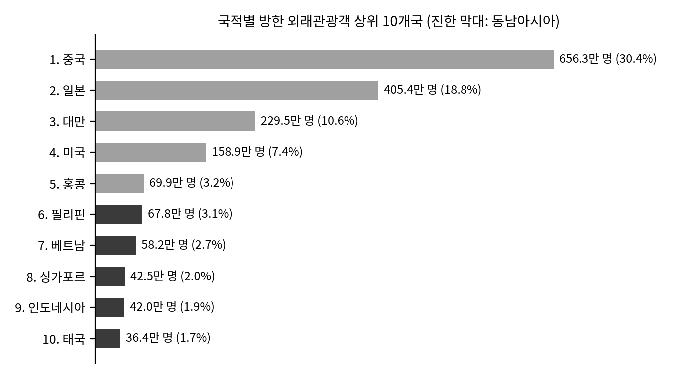

# SubFit 제안서 (2026.10.11 제출본)

> 이 파일은 제출한 Word 문서를 Markdown으로 변환한 **참고용 사본**입니다. 표지·서명·목차는 뺐습니다.
> **데이터 출처, 노선 범위, 부가 기능 범위는 이 문서가 아니라 `data/extra/ASSUMPTIONS.md`가 우선**입니다.
> (설계서 제출 이후 교수님 제공 가상 노선 데이터로 변경됨)

# 요약문

본 프로젝트는 AI 기반 다국어 지하철 길찾기 및 모임역 추천 애플리케이션 개발을 목표로 하며, 한국 지하철 이용에 어려움을 겪는 외국인 사용자에게 다국어 경로 안내 서비스를 제공합니다. 최근 한국을 방문하는 외국인 관광객, 유학생, 외국인 근로자의 수가 늘고 있지만, 복잡한 지하철 노선과 환승 체계 때문에 이동 과정에서 어려움을 겪는 경우가 많습니다. 또한 기존 지하철 앱은 한국어 중심이거나 영어, 일본어, 중국어 등 일부 언어만 지원하는 경우가 많아 다양한 국적의 사용자가 이용하기에는 한계가 있습니다.

이를 해결하기 위해 본 앱은 AI를 활용하여 사용자가 선택한 언어로 지하철 경로를 안내하고, 환승 방법과 이동 정보를 이해하기 쉬운 문장으로 설명합니다. 또한 여러 사용자의 출발역을 입력받아 이동 시간과 환승 횟수를 고려한 최적의 모임역을 추천합니다. 주요 사용자 요구사항으로는 최단 시간 및 최소 환승 경로 제공, 선택한 언어로의 결과 안내, 모임역 추천과 추천 이유 설명이 포함됩니다. 이 프로젝트를 통해 한국 지하철 이용 경험을 개선하고, 다양한 국적의 사용자가 보다 쉽고 편리하게 대중교통을 이용할 수 있을 것으로 기대됩니다.

## Abstract

This project aims to develop an AI-based multilingual subway navigation and meeting-station recommendation application that provides multilingual route guidance to foreigners who have difficulty using the Korean subway. The number of foreign tourists, international students, and foreign workers visiting Korea has been increasing, but many of them struggle while traveling because of the complex subway lines and transfer system. In addition, existing subway apps are often centered on Korean or support only a few languages such as English, Japanese, and Chinese, which limits their use by people of diverse nationalities.

To solve this problem, the app uses AI to guide subway routes in the language selected by the user and explains transfer methods and travel information in easy-to-understand sentences. It also takes the departure stations of several users and recommends the best meeting station by considering travel time and the number of transfers. The main user requirements include providing the fastest and fewest-transfer routes, presenting results in the selected language, and recommending a meeting station with an explanation of the reason. Through this project, we expect to improve the experience of using the Korean subway and help users of various nationalities use public transportation more easily and conveniently.

# 1. 프로젝트 개요

## 1.1 프로젝트 배경

최근 한국을 방문하는 외국인 관광객, 유학생, 외국인 근로자의 수가 늘고 있습니다. 한국관광공사 한국관광 데이터랩의 통계에 따르면 2025년 9월부터 2026년 8월까지 방한 외래관광객은 2,160만 5,499명으로 전년 동기(1,807만 6,000명) 대비 19.5% 증가했으며\[1\], 2025년 12월 말 국내 체류외국인은 약 278만 명입니다\[2\]. 그러나 외국인 사용자는 복잡한 지하철 노선과 환승 체계 때문에 이동 과정에서 어려움을 겪는 경우가 많고(2.1절 참고), 기존 지하철 앱은 한국어 중심이거나 일부 언어만 지원하는 경우가 많아 다양한 국적의 사용자가 이용하기에는 한계가 있습니다.

## 1.2 프로젝트 목적

본 프로젝트의 목적은 AI 기반 다국어 지하철 길찾기 및 모임역 추천 애플리케이션을 개발하여, 한국 지하철 이용에 어려움을 겪는 외국인 사용자에게 다국어 경로 안내 서비스를 제공하는 것입니다. 설계 제품의 명칭은 "SubFit"으로 설정하였습니다.

본 프로젝트의 주안점은 언어 장벽을 줄이는 것과 약속 장소를 정하는 과정을 편리하게 만드는 것입니다. 이를 위해 AI를 활용하여 영어, 중국어, 일본어뿐 아니라 베트남어, 태국어, 인도네시아어 등 다양한 언어로 경로를 안내하고, 환승 정보를 일상적인 문장으로 풀어 설명하여 사용자가 쉽게 이해할 수 있도록 설계할 예정입니다. 또한 여러 사용자의 출발 위치를 기반으로 이동 시간과 환승 횟수를 고려한 모임역을 추천하여, 약속 장소 선정 과정에서 발생하는 불편함을 최소화하고자 합니다.

## 1.3 주요 사용자

주 사용 대상자는 외국인 관광객, 외국인 유학생, 외국인 근로자, 그리고 한국을 방문하는 여행객입니다.

## 1.4 서비스 범위

\[표 1\] 서비스 범위

| **항목**  | **내용**                                                                  |
|-----------|---------------------------------------------------------------------------|
| 플랫폼    | Android (Android 11 이상)                                                 |
| 데이터    | 서울 열린데이터광장과 공공데이터포털의 지하철 노선·역 정보 공공데이터     |
| 지원 언어 | 20개 이상 지원, 이후 70개 이상으로 확장할 수 있는 구조                    |
| 핵심 기능 | 길찾기, 다국어 안내, 모임역 추천 (부가 기능은 일정에 여유가 있을 때 추가) |

## 1.5 주요 기능 및 서비스 개요

1)  **길찾기:** 출발역과 도착역을 입력하면 최단 시간 경로와 최소 환승 경로를 제공합니다.

2)  **다국어 안내:** 사용자가 선택한 언어로 결과를 제공하고, AI를 활용하여 환승 과정을 알기 쉬운 문장으로 설명합니다.

3)  **모임역 추천:** 여러 명의 출발역을 입력받아 이동 시간과 환승 횟수를 고려한 최적의 모임역을 추천하고, AI가 추천 이유를 설명합니다.

## 1.6 기대효과

이 프로젝트를 통해 한국 지하철 이용 경험을 개선하고, 다양한 국적의 사용자가 보다 쉽고 편리하게 대중교통을 이용할 수 있을 것으로 기대됩니다. 또한 모임역 추천을 통해 약속 장소 선정 과정에서 발생하는 불편함을 줄일 수 있습니다.

#  2. 현황 분석 및 필요성

## 2.1 현재 지하철 이용 환경 및 문제점

한국을 찾는 외국인 사용자는 다양한 국적으로 늘어나고 있습니다. 한국관광 데이터랩의 국적별 방한 외래관광객 통계\[1\]를 보면, 방한객은 200개 이상의 국가·지역에서 왔으며 중국(30.4%), 일본(18.8%), 대만(10.6%), 미국(7.4%), 홍콩(3.2%)의 상위 5개국이 전체의 약 70.4%를 차지합니다. 그 뒤를 필리핀(6위), 베트남(7위), 싱가포르(8위), 인도네시아(9위), 태국(10위), 말레이시아(11위)가 잇고 있으며, 이 동남아시아 6개국 방한객은 합계 약 282만 명으로 전체의 약 13.1%이고 전년 동기 대비 약 12.1% 증가했습니다(6개국 합계와 비율은 \[1\]의 수치를 합산하여 계산).

장기 체류자도 많습니다. 2025년 12월 말 국내 체류외국인은 약 278만 명이며\[2\], 외국인 유학생은 2025년 30만 8,838명에서 2026년 3월 32만 6,385명으로 늘었고, 그중 베트남 국적이 12만 2,734명(약 37.6%)으로 가장 많습니다\[3\].

\[그림 1\] 국적별 방한 외래관광객 상위 10개국 (출처: \[1\])

그러나 외국인 사용자는 복잡한 지하철 노선과 환승 체계, 그리고 한국어 중심의 역 안 안내 때문에 이동 과정에서 어려움을 겪는 경우가 많습니다. 이러한 문제는 다음과 같은 자료에서 확인할 수 있습니다.

1)  **역 안 안내의 언어 장벽:** 2026년 2월 보도에 따르면, 한 시민이 서울역에서 한 시간 동안 외국인 5명의 길 찾기를 도왔는데 모두 역사 내 외국어 표기가 충분하지 않아 동선을 파악하지 못한 경우였습니다. 서울시 시민 제안 창구인 "상상대로 서울"에도 서울역·시청역에서 외국인이 환승 방향과 개찰구 위치를 찾기 어렵다는 제안이 올라왔으며, 역무원 호출 버튼을 눌러도 언어 장벽 때문에 바로 소통이 되지 않는 사례도 보고되었습니다\[12\].

2)  **길고 복잡한 환승 동선:** 서울시는 환승 불편이 집중된 13개 역사를 대상으로 "전 역사 10분 내 환승" 사업을 추진한다고 발표하였습니다. 이들 역사의 교통약자 평균 환승 시간은 23.3분이며, 건대입구역(2·7호선)은 휠체어 이용 시 환승에 최대 35분이 걸립니다\[13\]. 또한 서울시와 서울교통공사의 실증조사에서는 환승 과정의 가장 큰 불편이 엘리베이터 위치 파악, 출구용·환승용 엘리베이터 구분 등 엘리베이터와 관련된 구간에서 발생하는 것으로 나타났습니다\[14\]. 큰 짐을 든 외국인 관광객도 같은 동선을 이용하므로 비슷한 불편을 겪을 수 있습니다.

3)  **외국인의 통역·교통 문의:** 문화체육관광부와 한국관광공사가 1330 관광통역안내 문의 데이터 24만여 건을 분석한 결과, 가장 많이 언급된 주제어는 "통역"이었고, 공항·터미널에서 여행지로 이동하는 교통편과 교통카드 이용 방법에 대한 문의 비중은 전년 같은 기간보다 25% 증가하였습니다\[15\].

4)  **외국인 이용자의 실제 사례:** 해외여행 커뮤니티에서도 비슷한 어려움을 찾을 수 있습니다. 싱가포르의 한 여행객은 공항철도로 큰 짐을 옮길 예정인데 명동역에 엘리베이터나 에스컬레이터가 있는지 묻는 글을 올렸고, 답변 중에는 에스컬레이터가 있는 출구를 이용했는데도 역 안에서는 짐을 들고 계단을 오르내려야 했다는 경험이 공유되었습니다\[16\].

5)  **해외 사례:** 일본 관광청 조사에서도 방일 외국인이 여행 중 겪은 불편으로 "환승·경로 등 대중교통 이용"이 12.3%로 나타났고\[17\], 철도역에서 의사소통에 어려움을 겪은 응답자의 62.4%가 "목적지까지 가는 길을 설명하거나 묻는 상황"을 꼽았습니다\[18\]. 이는 대중교통 환승과 역 안 길 찾기가 외국인 관광객에게 공통적인 어려움임을 보여 줍니다.

## 2.2 기존 지하철 앱 및 서비스 분석

현재의 지하철 앱들은 길찾기 기능은 갖추고 있지만, 다국어 지원이 일부 언어에 그치고 환승 과정을 문장으로 풀어 주는 안내가 제한적이며, 여러 명이 만날 역을 추천하는 기능은 제공하지 않습니다.

## 2.3 기존 서비스의 한계

1)  **다국어 지원:** 일부 언어(영어, 일본어, 중국어 중심)만 지원하여 다양한 국적의 사용자가 이용하기에는 한계가 있습니다.

2)  **단계별 문장 안내:** 환승 방법과 이동 정보를 문장으로 설명하는 기능이 제한적입니다.

3)  **모임역 추천:** 여러 명이 만날 역을 추천하는 기능을 제공하지 않습니다.

4)  **역 안 이동 정보의 언어 제한:** 국내 지도 앱이 교통약자를 위한 엘리베이터·출구 정보를 제공하더라도, 해당 정보가 영어로 표기되지 않아 외국인이 활용하기 어렵다는 지적이 있습니다\[19\].

## 2.4 사용자 요구 분석

사용자 요구사항은 앱이 반드시 제공해야 하는 기능을 기준으로 정의하였으며, 경로 안내, 다국어 안내, 모임역 추천의 세 영역으로 나누었습니다. 주요 사용자 요구사항은 최단 시간 및 최소 환승 경로 제공, 선택한 언어로의 결과 안내, 모임역 추천과 추천 이유 설명입니다. 세부 요구사항은 3.1절에 번호를 부여하여 정리하였습니다.

## 2.5 본 프로젝트의 필요성

이 프로젝트는 사용자층의 변화와 기존 제품 분석을 통해 필요성과 시장성을 명확히 하고자 합니다. 한국을 찾는 외국인 사용자는 다양한 국적으로 늘어나고 있지만 기존 앱의 다국어 지원은 일부 언어에 그치므로, 언어 장벽을 줄이고 약속 장소를 정하는 과정을 편리하게 만드는 서비스가 필요합니다.

## 2.6 기존 서비스 대비 차별성

본 프로젝트는 기존 앱의 부족한 부분을 보완하여 차별성을 확보하는 데 중점을 두고 있습니다. 기존 앱 대비 차별성은 다음과 같습니다.

\[표 2\] 기존 지하철 앱과 SubFit 비교

| **항목**         | **기존 앱**                           | **SubFit**                          |
|------------------|---------------------------------------|-------------------------------------|
| 길찾기           | O                                     | O                                   |
| 다국어 지원      | 일부 언어 (영어, 일본어, 중국어 중심) | 20개 이상 지원, 70개 이상 확장 가능 |
| 단계별 문장 안내 | 제한적                                | AI가 쉬운 문장으로 설명             |
| 모임역 추천      | X                                     | O (추천 이유 설명 포함)             |
| 언어 확장성      | 낮음                                  | 높음                                |

# 3. 기능, 성능 및 시스템 사항

## 3.1 기능 요구사항

기능 요구사항은 전체적인 구현 순서를 반영해 번호를 부여 하였으며, 경로 안내, 다국어 안내, 모임역 추천의 세 영역으로 나누어 분류하였습니다.

### 3.1.1 최소 필수 기능

\[표 3\] 최소 필수 기능 (경로 안내)

| **번호** | **구분**  | **요구사항**                                      |
|----------|-----------|---------------------------------------------------|
| FR-01    | 경로 안내 | 사용자는 출발역과 도착역을 입력할 수 있어야 한다. |
| FR-02    | 경로 안내 | 시스템은 최단 시간 경로를 제공해야 한다.          |
| FR-03    | 경로 안내 | 시스템은 최소 환승 경로를 제공해야 한다.          |

길찾기 기능은 Dijkstra 알고리즘을 기반으로 구현합니다.

### 3.1.2 차별화 부가 기능

\[표 4\] 차별화 부가 기능 (모임역 추천)

| **번호** | **구분**    | **요구사항**                                                             |
|----------|-------------|--------------------------------------------------------------------------|
| FR-06    | 모임역 추천 | 사용자는 여러 명의 출발역을 입력할 수 있어야 한다.                       |
| FR-07    | 모임역 추천 | 시스템은 이동 시간과 환승 횟수를 고려하여 최적의 모임역을 추천해야 한다. |

### 3.1.3 차별화 AI 활용 기능

\[표 5\] 차별화 AI 활용 기능

| **번호** | **구분**    | **요구사항**                                                             |
|----------|-------------|--------------------------------------------------------------------------|
| FR-04    | 다국어 안내 | 시스템은 사용자가 선택한 언어로 결과를 제공해야 한다.                    |
| FR-05    | 다국어 안내 | 시스템은 AI를 활용하여 환승 과정을 이해하기 쉬운 문장으로 설명해야 한다. |
| FR-08    | 모임역 추천 | AI는 모임역을 추천한 이유를 설명해야 한다.                               |

요구사항 예시는 다음과 같습니다.

1)  **FR-05 (영어):** Transfer to Line 2 at Sadang Station.

2)  **FR-05 (베트남어):** Chuyển sang tuyến số 2 tại ga Sadang.

    1.  위 두 문장은 모두 "사당역에서 2호선으로 환승하세요."라는 뜻입니다.

3)  **FR-08:** "사당역은 모든 사용자의 평균 이동 시간이 가장 짧아 추천되었습니다."

### 3.1.4 최종 세부 기능

\[표 6\] 최종 세부 기능

| **번호** | **구분**    | **요구사항**                                                             |
|----------|-------------|--------------------------------------------------------------------------|
| FR-01    | 경로 안내   | 사용자는 출발역과 도착역을 입력할 수 있어야 한다.                        |
| FR-02    | 경로 안내   | 시스템은 최단 시간 경로를 제공해야 한다.                                 |
| FR-03    | 경로 안내   | 시스템은 최소 환승 경로를 제공해야 한다.                                 |
| FR-04    | 다국어 안내 | 시스템은 사용자가 선택한 언어로 결과를 제공해야 한다.                    |
| FR-05    | 다국어 안내 | 시스템은 AI를 활용하여 환승 과정을 이해하기 쉬운 문장으로 설명해야 한다. |
| FR-06    | 모임역 추천 | 사용자는 여러 명의 출발역을 입력할 수 있어야 한다.                       |
| FR-07    | 모임역 추천 | 시스템은 이동 시간과 환승 횟수를 고려하여 최적의 모임역을 추천해야 한다. |
| FR-08    | 모임역 추천 | AI는 모임역을 추천한 이유를 설명해야 한다.                               |

## 3.2 성능 요구사항

사용자가 이동 중에 바로 확인할 수 있어야 하므로 응답 시간을 제한하며, 기능별 목표는 다음과 같습니다. 측정 방법은 5장에서 구체화합니다.

\[표 7\] 성능 요구사항

| **항목**               | **목표값**                         | **측정 방법**                                      |
|------------------------|------------------------------------|----------------------------------------------------|
| 경로 탐색 응답 시간    | 2초 이하                           | 다양한 시나리오에서 응답 속도 측정                 |
| AI 설명 생성 응답 시간 | 5초 이하                           | 다양한 시나리오에서 응답 속도 측정                 |
| 경로 탐색              | 성공률 95% 이상                    | 여러 출발역·도착역 조합으로 경로 검색 정확도 측정  |
| 모임역 추천            | 성공률 90% 이상                    | 추천 결과가 이동 시간·환승 횟수 기준에 맞는지 검증 |
| 번역 품질              | 사용자 번역 만족도 80% 이상        | 언어별 안내 문장 만족도 조사                       |
| 기능 접근성            | 주요 기능에 3회 이내 조작으로 접근 | 사용자 평가                                        |
| 사용자 만족도          | 평균 만족도 80점 이상              | 팀 외 20명 이상 테스트 및 설문                     |

## 3.3 시스템 요구사항

프로젝트는 Android 플랫폼을 목표로 하며, 개발 환경은 다음과 같습니다. 지하철 노선과 역 정보는 서울 열린데이터광장과 공공데이터포털의 공공데이터를 활용합니다.

\[표 8\] 개발 환경

| **구분**   | **기술**          | **선정 이유**                                                                                                                                                                                                                            |
|------------|-------------------|------------------------------------------------------------------------------------------------------------------------------------------------------------------------------------------------------------------------------------------|
| Front-End  | Flutter           | Flutter는 단일 코드 베이스로 Android 앱을 개발하면서 이후 다른 플랫폼으로도 확장할 수 있으며, 풍부한 UI 컴포넌트를 제공하여 모바일 애플리케이션 개발에 적합하다. 또한 높은 성능과 안정성을 제공하여 본 프로젝트에 적합하다고 판단하였다. |
| UI/UX 설계 | Figma             | Figma는 화면 흐름(Flow)과 프로토타입을 시각적으로 설계할 수 있어 지하철 길찾기 및 모임역 추천 기능의 사용자 경험을 사전에 검증하기에 적합하다. 또한 팀원 간 실시간 협업이 가능하여 설계 과정의 효율성을 높일 수 있다고 판단하였다.       |
| Back-End   | FastAPI           | FastAPI는 REST API 중심 서비스 개발에 적합한 프레임워크로, 높은 성능과 자동 API 문서화 기능을 제공한다. 또한 Python 기반으로 Gemini API 및 다양한 데이터 처리 라이브러리와의 연동이 용이하여 본 프로젝트에 적합하다고 판단하였다.        |
| Database   | PostgreSQL        | PostgreSQL은 안정성이 높고 대규모 데이터 처리에 적합한 오픈소스 관계형 데이터베이스이다. 지하철 노선, 역 정보, 환승 정보와 같은 관계형 데이터를 효율적으로 관리할 수 있으며, 복잡한 조회 및 검색 기능 구현에 적합하다고 판단하였다.      |
| AI         | Google Gemini API | Gemini API는 GPT 계열 모델 대비 비용이 저렴하며, 다국어 처리 성능이 우수하여 예산 범위 내에서 활용 가능하다고 판단하였다.                                                                                                                |
| 지원 기기  | Android 11 이상   | Android 11 이상은 최신 API와 보안 기능을 안정적으로 지원한다. 또한 개발 및 테스트 범위를 적절히 제한하여 프로젝트 기간 내 안정적인 구현이 가능하다고 판단하였다.                                                                         |

## 3.4 현실적 제한 조건

본 프로젝트에서는 사용자 요구를 충족하고 앱 개발을 성공적으로 완료하기 위해 다음과 같은 현실적 제한조건을 설정하였습니다. 이러한 제한조건들은 불필요한 제약 없이 필수적인 요소만을 포함하며, 가능한 한 정량적으로 정의되었습니다.

1)  **개발 기간:** 전체 개발 기간은 12주로 제한되며, 이 기간 내에 모든 기능을 구현하고 테스트와 발표 준비까지 완료해야 합니다. 기획 2주, 설계 2주, 구현 5주, 테스트 2주, 발표 준비 1주로 배분합니다.

2)  **팀 인력 및 기술적 한계:** 본 팀은 총 2명으로 구성되어 있으며, 각 팀원이 업무를 나누어 맡습니다. 한정된 인원과 기간 안에서 모든 기능을 완성해야 하므로, 길찾기, 다국어 안내, 모임역 추천의 세 가지 핵심 기능을 우선 구현하고 부가 기능은 일정에 여유가 있을 때 추가합니다.

3)  **예산:** 학생 프로젝트로 진행되므로 총 예산을 50,000원 이하로 제한합니다. 대부분의 개발 도구는 무료 또는 오픈소스를 사용하며, 비용은 AI API 사용료와 테스트 비용을 중심으로 배정합니다.

4)  **사용자 경험(UX):** 외국인 사용자가 처음 사용하더라도 원하는 기능을 바로 찾을 수 있도록, 경로 검색과 모임역 추천 같은 주요 기능에 3회 이내의 조작으로 접근할 수 있게 설계합니다. 언어 선택 결과는 경로 결과와 환승 설명 등 화면 전체에 동일하게 적용되도록 합니다.

5)  **성능:** 경로 탐색 응답 시간은 2초 이하, AI 설명 생성 응답 시간은 5초 이하로 제한합니다.

\[표 9\] 예산 계획

| **항목**   | **비용**     |
|------------|--------------|
| Gemini API | 20,000원     |
| 테스트     | 10,000원     |
| 기타       | 20,000원     |
| **총합**   | **50,000원** |

\[표 10\] 현실적 제한조건 요약

| **제한조건**    | **세부 내용**                            | **정량적 정의**            |
|-----------------|------------------------------------------|----------------------------|
| 개발 기간       | 기획, 설계, 구현, 테스트, 발표 준비 완료 | 12주                       |
| 팀 인력         | 역할을 나누어 핵심 기능 우선 구현        | 팀원 2명                   |
| 개발 환경       | Flutter, FastAPI, PostgreSQL, Gemini API | Android                    |
| 예산            | API 사용료, 테스트 비용 중심             | 50,000원 이하              |
| 사용자 경험(UX) | 주요 기능에 빠르게 접근                  | 3회 이내 조작              |
| 성능            | 경로 탐색 및 AI 설명 응답 시간 제한      | 경로 2초 이하, AI 5초 이하 |

# 4. 개발 전략

## 4.1 팀 구성 및 업무 분담

\[표 11\] 팀원의 업무 분담

| **이름** | **역할**              | **담당 업무**                                                                                            |
|----------|-----------------------|----------------------------------------------------------------------------------------------------------|
| 이 진    | 팀장 / 백엔드 / AI    | 프로젝트 총괄, 일정 관리, API 적용, DB 설계, Gemini API 연동, 번역 기능 구현, 모임역 추천 설명 기능 구현 |
| 표혜정   | 프론트엔드 / 알고리즘 | UI 개발, 다국어 화면 구성, Dijkstra 기반 길찾기 및 모임역 계산 알고리즘 구현                             |

## 4.2 일정 계획

\[표 12\] 일정표

| **주차**  | **주요 작업**            | **담당 팀원** | **비고**                 |
|-----------|--------------------------|---------------|--------------------------|
| 1~2주차   | 요구사항 분석            | 모든 팀원     | 기획, 제안서 작성        |
| 3~4주차   | DB 설계, UI 설계         | 모든 팀원     | 설계                     |
| 5~6주차   | 길찾기 기능 구현         | 표혜정        | 구현 (Dijkstra 기반)     |
| 7~8주차   | AI 다국어 기능 구현      | 이 진         | 구현 (Gemini API 연동)   |
| 9주차     | 모임역 추천 기능 구현    | 모든 팀원     | 구현                     |
| 10~11주차 | 통합 테스트, 사용자 평가 | 모든 팀원     | 테스트 (팀 외 20명 이상) |
| 12주차    | 발표 준비 및 최종 발표   | 모든 팀원     | 발표 진행                |

## 4.3 개발 방법론 및 프로세스

한정된 인원과 기간 안에서 모든 기능을 완성해야 하므로, 길찾기, 다국어 안내, 모임역 추천의 세 가지 핵심 기능을 우선 구현하고 부가 기능은 일정에 여유가 있을 때 추가합니다.

## 4.4 프로젝트 관리 방안

프로젝트 진행 과정에서의 업무 및 자료 관리는 Notion, GitHub, KakaoTalk을 중심으로 운영합니다. Notion은 회의록, 보고서, 참고자료, 일정 및 역할 분담 내용을 통합하여 관리하는 공간으로 활용하며, 각 팀원의 업무 진행 상황과 완료 여부를 지속적으로 업데이트하여 전체 프로젝트 진행 현황을 확인합니다. 또한 회의 후 주요 결정사항과 수정사항을 기록하여 팀원 간 정보 누락을 방지합니다. GitHub는 소스 코드의 버전 관리와 협업을 위해 사용합니다. 안정적인 코드 관리를 위해 main 브랜치에 직접 수정하는 것을 최대한 지양하고, 각 기능별 또는 작업별 브랜치를 생성하여 개발을 진행합니다. 기능 구현이나 수정이 완료된 후에는 코드 확인 및 테스트를 거쳐 main 브랜치에 병합하며, 변경 내용을 커밋 메시지에 구체적으로 기록하여 수정 이력을 관리합니다. 또한 여러 팀원이 동일한 파일을 동시에 수정하는 상황을 최소화하기 위해 담당 기능별 파일을 구분하여 작업하고, 병합 충돌이 발생할 경우 팀원 간 확인 후 수정하도록 합니다. KakaoTalk은 빠른 의사소통이 필요한 경우 활용하며, 일정 변경, 오류 발생, 긴급 수정사항, 즉각적인 피드백이 필요한 내용을 공유합니다. 단순 대화로 끝나는 것을 방지하기 위해 주요 결정사항이나 업무 변경 내용은 이후 Notion에 다시 정리하여 기록합니다.

## 4.5 팀 협업 전략

각 팀원은 담당 영역을 중심으로 개발하되, 기능 간 연결이 필요한 부분에서는 협업을 진행합니다. 프로젝트 후반의 통합 및 품질 검증 단계에서는 기존 역할과 관계없이 모든 팀원이 오류 수정에 참여합니다.

## 4.6 리스크 관리

\[표 13\] 리스크 관리

<table>
<colgroup>
<col style="width: 8%" />
<col style="width: 39%" />
<col style="width: 10%" />
<col style="width: 41%" />
</colgroup>
<thead>
<tr class="header">
<th><strong>번호</strong></th>
<th><strong>예상 문제</strong></th>
<th><strong>영향</strong></th>
<th><strong>대응 방안</strong></th>
</tr>
</thead>
<tbody>
<tr class="odd">
<td>R-01</td>
<td>다국어 번역 누락 및 표현 오류</td>
<td>중간</td>
<td>자주 사용되는 역명·메뉴·길찾기 안내 문구를 우선 번역한다.</td>
</tr>
<tr class="even">
<td>R-02</td>
<td>실시간 지하철 API 장애 또는 응답 지연</td>
<td>높음</td>
<td>
오류 메시지를 제공하고, 최근 조회 정보

또는 정적 데이터를 활용한다.
</td>
</tr>
<tr class="odd">
<td>R-03</td>
<td>API 호출 횟수 제한 초과</td>
<td>중간</td>
<td>
역 단위 캐시를 적용하고 동일한 데이터의

반복 호출을 줄인다.
</td>
</tr>
<tr class="even">
<td>R-04</td>
<td>경로 탐색 알고리즘의 잘못된 결과</td>
<td>높음</td>
<td>
간단한 노선 데이터부터 단계적으로 테스트하고, 실제 지하철 경로와 비교하여 최단시간 및

최소환승 결과의 정확성을 검증한다.
</td>
</tr>
<tr class="odd">
<td>R-05</td>
<td>모임역 추천 결과의 편향 또는 부적절한 추천</td>
<td>높음</td>
<td>평균 이동시간과 이동시간 편차 등 추천 기준을 명확히 정의한다.</td>
</tr>
<tr class="even">
<td>R-06</td>
<td>환승역 및 환승시간 처리 오류</td>
<td>높음</td>
<td>
환승역을 노선별로 구분하여 그래프를 구성하고, 환승 여부와 환승시간을 별도의 비용으로

반영하여 테스트한다.
</td>
</tr>
<tr class="odd">
<td>R-07</td>
<td>실시간 정보와 실제 운행 정보의 차이 발생</td>
<td>중간</td>
<td>실시간 정보는 외부 API 결과임을 명시하고, 조회 시각을 함께 표시하여 사용자가 정보의 기준 시점을 확인할 수 있도록 한다.</td>
</tr>
<tr class="even">
<td>R-08</td>
<td>이동편의시설 데이터 부족 또는 변경</td>
<td>중간</td>
<td>엘리베이터·에스컬레이터 정보가 확보된 역부터 기능을 제공하고, 데이터가 없는 경우 ‘정보 없음’으로 표시하여 잘못된 정보를 제공하지 않도록 한다.</td>
</tr>
<tr class="odd">
<td>R-09</td>
<td>API Key 등의 중요 정보 노출</td>
<td>높음</td>
<td>코드에 직접 작성하지 않고 서버 환경변수로 관리하며, 설정 파일은 Git추적에서 제외한다..</td>
</tr>
</tbody>
</table>

#  5. 검증 및 테스트 방안

SubFit의 설계 및 개발 결과를 평가하기 위해 다음과 같은 방법을 사용합니다.

## 5.1 검증 및 품질 관리 전략

평가 항목과 목표 기준은 표 14와 같으며, 항목별 세부 검증 방법은 다음과 같습니다.

\[표 14\] 평가 항목과 목표 기준

| **평가 항목** | **평가 방법**                  | **목표 기준**              |
|---------------|--------------------------------|----------------------------|
| 경로 탐색     | 경로 검색 결과 정확도 측정     | 성공률 95% 이상            |
| 모임역 추천   | 추천 결과 검증                 | 성공률 90% 이상            |
| 다국어 안내   | 사용자 만족도 조사             | 번역 만족도 80% 이상       |
| 성능          | 응답 속도, 오류율 측정         | 경로 2초 이하, AI 5초 이하 |
| 사용자 평가   | 팀 외 20명 이상 테스트 및 설문 | 평균 만족도 80점 이상      |

### 5.1.1 경로 탐색 알고리즘 검증

1)  **경로 탐색:** 여러 출발역과 도착역 조합으로 경로를 검색하여 정확도를 측정합니다. (목표: 성공률 95% 이상)

2)  **모임역 추천:** 여러 명의 출발역을 입력하여 추천 결과가 이동 시간과 환승 횟수 기준에 맞는지 검증합니다. (목표: 성공률 90% 이상)

### 5.1.2 AI 다국어 안내 기능 검증

1)  **다국어 안내:** 언어별 안내 문장에 대한 사용자 만족도를 조사합니다. (목표: 번역 만족도 80% 이상)

### 5.1.3 성능 테스트

1)  다양한 시나리오에서 경로 탐색과 AI 설명 생성의 응답 속도를 측정합니다. (목표: 경로 2초 이하, AI 5초 이하)

2)  기능별 오류 발생 횟수를 기록하여 오류율을 측정합니다.

### 5.1.4 주요 기능 통합 테스트

1)  10~11주차에 통합 테스트를 진행합니다.

2)  팀 외 사용자 20명 이상을 대상으로 앱 사용 테스트를 진행하고, 테스트 후 설문조사를 통해 만족도와 개선 의견을 수집합니다. (목표: 평균 만족도 80점 이상)

### 5.1.5 보안 점검

보안 점검은 통합 테스트 기간에 다음 항목을 체크리스트로 만들어 확인합니다.

1)  **API 키 관리:** Gemini API 키와 공공데이터 인증키는 서버의 환경변수로만 관리하고, 앱 코드와 코드 저장소에는 포함하지 않습니다. 배포 전에는 앱 빌드 파일에 키가 들어 있지 않은지 확인합니다.

2)  **통신 보안:** 앱과 서버 사이의 모든 통신은 HTTPS로 암호화합니다.

3)  **개인정보 최소 수집:** 경로 검색에 필요한 출발역·도착역 정보만 사용하고, 이름이나 연락처처럼 개인을 식별할 수 있는 정보는 수집하지 않습니다.

4)  **AI 입력 검증:** 사용자 입력은 길이와 형식을 검사한 뒤 AI에 전달하고, 사용자별 호출 횟수를 제한하여 비정상적인 사용과 API 비용 초과를 막습니다.

## 5.2 오류 및 품질 관리

오류는 발견 즉시 기록하고, 서비스에 미치는 영향에 따라 우선순위를 정해 처리합니다.

1)  **긴급:** 앱 실행 불가, 잘못된 경로 안내, 서버 중단처럼 핵심 기능이 동작하지 않는 오류는 즉시 수정합니다.

2)  **높음:** AI 설명 생성 실패, 번역 오류, 응답 시간 목표(경로 2초, AI 5초) 초과 등은 다른 작업보다 먼저 수정합니다.

3)  **일반:** 화면 배치나 문구 수정 등 사용 편의와 관련된 문제는 일정에 맞춰 순차적으로 수정합니다.

수정은 "오류 기록(발생 상황, 재현 방법, 담당자) → 원인 분석 → 수정 → 해당 기능 재테스트 → 관련 기능 회귀 테스트" 순서로 진행하며, 수정 내용을 오류 기록에 함께 남겨 같은 오류가 반복되지 않도록 관리합니다.

## 5.3 업데이트 및 유지보수 전략

지하철 노선·역 정보와 외부 API는 서비스 운영 중에도 바뀔 수 있으므로, 변경 유형별로 다음과 같이 대응합니다.

1)  **노선·역 정보 변경:** 공공데이터를 정기적으로 다시 내려받아 DB를 갱신하고, 변경된 구간의 경로 탐색 결과를 다시 확인합니다.

2)  **외부 API 변경:** 공공데이터 API와 Gemini API 연동 부분을 별도 모듈로 분리하여, API 형식이나 정책이 바뀌어도 해당 모듈만 수정하도록 합니다.

3)  **AI 모델 변경:** 모델을 바꾸거나 업데이트한 경우, 언어별 예시 문장으로 안내 문장의 품질을 다시 확인합니다.

4)  **지원 언어 확장:** 새 언어를 추가할 때는 예시 안내 문장을 생성해 검수한 뒤 적용합니다.

유지보수는 "변경 사항 확인 → 영향 범위 분석 → 수정 → 테스트 → 배포 → 정상 동작 확인" 순서로 진행합니다.

# 참고 문헌

\[1\] 한국관광공사, 한국관광 데이터랩, 「글로벌 방한관광객」 국적별 방한 외래관광객 통계(CSV), 2026.10.07 조회. https://datalab.visitkorea.or.kr

\[2\] 관계부처 합동, 「2026년 외국인정책 시행계획(중앙행정기관)」, 2026.4. https://www.immigration.go.kr/bbs/immigration/226/493596/download.do

\[3\] 법무부, 보도자료 「법무부, 유학생 비자정책 방향 설정을 위한 민관협의체 출범」 붙임2 외국인 유학생 주요 통계, 2026.04.20. https://www.moj.go.kr/bbs/moj/182/493687/download.do

\[4\] 서울특별시. 서울 열린데이터광장. https://data.seoul.go.kr

\[5\] 행정안전부. 공공데이터포털. https://www.data.go.kr

\[6\] 카카오. 카카오지하철. 모바일 애플리케이션.

\[7\] 네이버. 네이버 지도. https://map.naver.com

\[8\] Google. Google Maps. https://www.google.com/maps

\[9\] Google. Gemini API Documentation. https://ai.google.dev/gemini-api/docs

\[10\] Google. Flutter Documentation. https://docs.flutter.dev

\[11\] FastAPI Documentation. https://fastapi.tiangolo.com

\[12\] 한국경제, 서울 주요 지하철역의 한국어 위주 안내로 인한 외국인 이용객 혼란 관련 보도, 2026.02.13. https://www.hankyung.com/article/202602135768i

\[13\] 뉴스서울, 「서울 지하철 全역사 엘리베이터 설치 완료… 환승은 짧게, 시민 일상은 더 길게」(서울시 "전 역사 10분 내 환승" 추진 발표), 2025.12. https://newsseoul.co.kr/news/view/1065607827067761

\[14\] 세계일보, 서울시·서울교통공사 지하철 환승 동선 실증조사 관련 보도, 2025.09.17. https://www.segye.com/newsView/20250917516356

\[15\] 문화체육관광부·한국관광공사, 「1330 서비스 이용 트렌드 분석서」, 2024.08. https://knto.or.kr/pressRelease/548690

\[16\] Tripadvisor 여행 포럼, "Elevators / Escalators at Myeongdong Station". https://www.tripadvisor.com.au/ShowTopic-g294197-i8161-k11213346-Elevators_Escalators_at_Myeongdong_Station-Seoul.html

\[17\] travelvoice.jp, "International visitors to Japan with problems in long time waiting for immigration increase by 2.4 times"(일본 관광청 2024.12~2025.1 조사 보도). https://www.travelvoice.jp/english/international-visitors-to-japan-with-problems-in-long-time-waiting-for-immigration-increase-by-2-4-times

\[18\] travelvoice.jp, "The biggest difficulty for international visitors in traveling in Japan is communication with facility staff"(일본 관광청 조사 보도). https://www.travelvoice.jp/english/the-biggest-difficulty-for-international-visitors-in-traveling-in-japan-is-communication-with-facility-staff

\[19\] FlyerTalk Forums, "Seoul subway layout map (elevator/escalator vs stairs)", 2023.11.13. https://www.flyertalk.com/forum/35742620-post4.html
